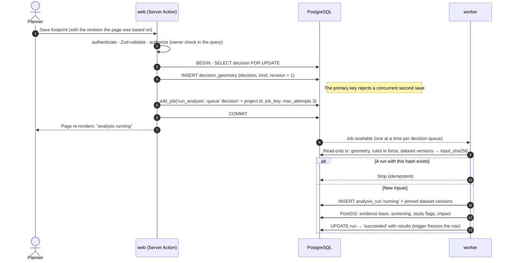
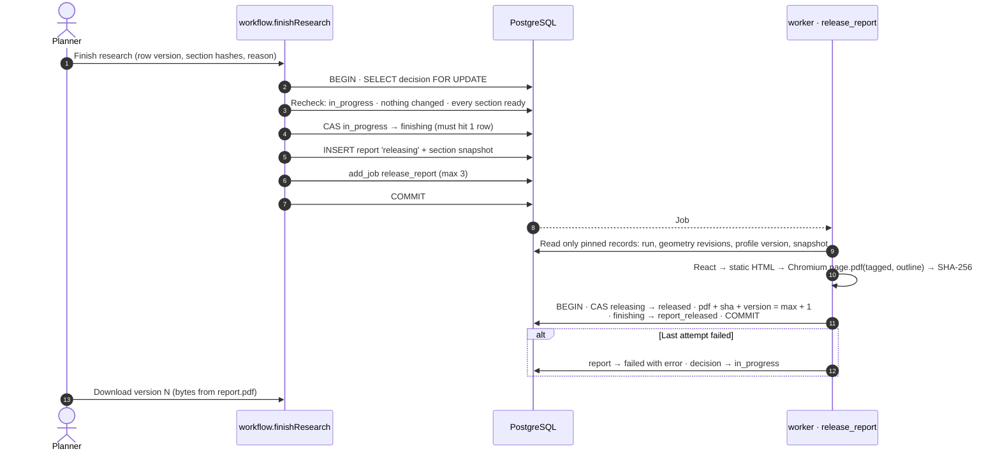
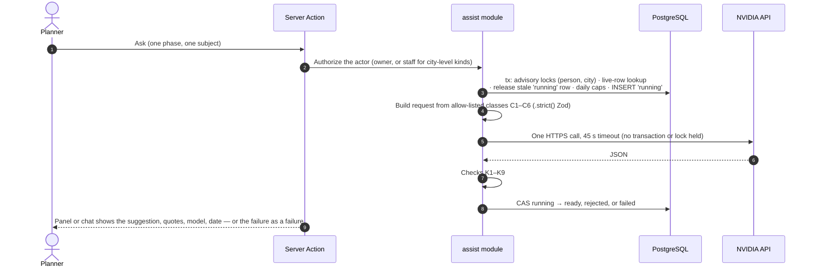

# UPlan

**Evidence software for municipal planners deciding whether land should be developed or preserved.**

UPlan is a web application that helps a city planner assemble the environmental evidence behind a land-use decision, measure what a proposed development would disturb, and publish a defensible, locked report. It is built for the pilot city of Sammamish, Washington, and designed so that another city is a new **jurisdiction profile** rather than a rewrite.

The guiding sentence in the project charter is:

> UPlan structures the decision; it never makes the call.

That single posture explains most of the architecture: every figure carries provenance, screening can flag a reason to look closer but can never clear land, released reports are immutable, and the language model may read and quote but may never measure, decide, or write the report.

> **Status (October 2026):** Release 1 is largely implemented and runnable locally. `Requirements/features.md` records per-feature status; the technical docs record what is built, what is backend-only, and what is designed for later.

---

## Table of contents

- [1. What UPlan is](#1-what-uplan-is)
- [2. Core ideas and vocabulary](#2-core-ideas-and-vocabulary)
- [3. The planner's journey](#3-the-planners-journey)
- [4. How the system works](#4-how-the-system-works)
- [5. Technology stack](#5-technology-stack)
- [6. Data model](#6-data-model)
- [7. Repository structure](#7-repository-structure)
- [8. Running UPlan locally](#8-running-uplan-locally)
- [9. Testing and quality gates](#9-testing-and-quality-gates)
- [10. Deployment](#10-deployment)
- [11. Security, privacy, and compliance](#11-security-privacy-and-compliance)
- [12. Where to read more](#12-where-to-read-more)
- [13. Glossary](#13-glossary)

---

## 1. What UPlan is

### The problem

When a city considers a subdivision, a short subdivision, or a clearing-and-grading permit, the ecological facts are scattered across county, state, and federal datasets, PDFs, and agency websites. A planner rebuilds the evidence by hand for every application and often learns late which regulated critical areas a site touches, or which studies an application should include.

UPlan does three jobs:

1. **Scope the studies a site owes.** Before an application is filed, show which regulated critical areas a site likely touches and which studies those critical areas point to.
2. **Assemble an independent evidence base.** Gather public ecological data over the study area, show disagreements and gaps instead of smoothing them over, and attach source, date, and confidence to every figure.
3. **Measure the proposal's impact.** Trace what the proposal would clear, grade, or build, and measure what it would remove or disturb for each regulated resource and buffer.

It then turns that work into a **locked, versioned PDF report** written for the planning commission and city council.

### Who uses it

| Person | What they do in UPlan |
| --- | --- |
| **Planner** (everyone signed in) | Creates projects, works through the research phases, maintains the city profile, and publishes report versions. A planner sees only the projects they created. |
| **UPlan staff** | A person with a `staff_member` row. Can install sample evidence, manage source documents and code text, confirm AI-drafted rule or metadata changes, and operate the deployment. Profile edits by planners apply immediately; a second staff member confirms an AI draft. Staff rights are granted only by an operator; registering grants nothing. |
| **Reviewer** | Designed for later in v1. Will review a project and sign off before a report is released. Not built yet. |
| **Residents / community groups** | Not users in v1. The report's audience is the commission and council, but it must hold up when read by residents, opponents, and attorneys. |

### What it is not

- It does **not** recommend developing or preserving.
- It does **not** clear land. An empty screening result is stated as a fact, never as "safe to develop" or "no study needed."
- It does **not** draft or propose conditions of approval. (Conditions tracing is a later feature.)
- It does **not** ingest or grade the applicant's studies.
- It does **not** use the model to measure, flag, decide, or write report text.

---

## 2. Core ideas and vocabulary

These words are used consistently in the screens, the code, and the design documents.

| Term | Meaning |
| --- | --- |
| **Decision** | The core object: a question about whether a specific proposal should be developed, and under what conditions. The database and code call it `decision`; the user interface calls it a **project**. |
| **Research** | The body of work a planner does on a project: the six phases, the evidence, the impact, and the document versions. The UI says "research"; the code says workflow. |
| **Jurisdiction profile** | One city's configuration: regulated resource types, buffer widths, study triggers, tree rules, vesting behavior, map status, and records settings. Held as an immutable JSON document per version, not as code. |
| **Study area** | The boundary the planner draws for the area assessed as a whole. It can cross parcel lines, because habitat does not follow parcel boundaries. Stored as geometry revisions. |
| **Proposal footprint** | The area the proposal would clear, grade, or build, traced by the planner from the application's site plan. The footprint is the thing under evaluation, not evidence. |
| **Evidence layer** | A public dataset mapped to a resource type in the profile (wetlands, streams, habitat, flood areas, geologic hazards, aquifer recharge areas, canopy). Each layer has a version, a publisher, a license, a date, and a confidence. |
| **Analysis run** | One computation over pinned inputs: geometry revisions, the profile version and rules in force, and the exact dataset versions. A run is deduplicated by an input hash and becomes immutable when it finishes. |
| **Phase** | One step of the research: Site, Evidence, Screening, Studies, Footprint, Impact. Overview and Report frame the phases but are not phases. |
| **Report section** | The part of the final document that a phase produces. The analysis engine drafts it from fixed templates; the planner reads it, asks questions about it, and can ask the section chat to change its narrative. Each change is an append-only version. |
| **Final document** | The released PDF, built only from pinned records, stored in the database with its SHA-256, and never changed afterward. Every research change produces a new numbered version. |
| **Research change** | An explicit reopening of completed research. Inputs change, the analysis reruns, affected sections become out of date, and publishing produces the next document version. |
| **Provenance** | Source, publisher date, retrieval date, and confidence, attached to every figure and carried into the map, the tables, the report, and exports. |

### The product principles

| Rule | What it means in practice |
| --- | --- |
| **P1. Provenance is the substrate** | Every stored figure carries its source, date, and confidence. All display formatting goes through `src/modules/provenance`, so the map and the PDF cannot disagree. |
| **P2. Screening never clears land** | No code path can produce "clear," "safe," or "no study needed." A flag can add a study; no flag ever removes one. |
| **P3. The report is the product; the map is the instrument** | Reports are built from pinned, immutable records. After release, the bytes and hash never change. |
| **Posture** | The system never recommends. The AI reads and quotes; the engine measures and decides nothing. |

### The AI boundary in one paragraph

The model may explain a drafted output, find the exact passage of code behind a rule, explain why two datasets may differ, turn recorded gaps into questions for a site visit or pre-application conference, and draft profile or dataset changes for staff to confirm. It may **not** measure, round, convert, flag, decide, recommend, clear, approve, deny, draft a condition, or write a sentence of the report. Its output is stored beside the analysis, never inside it, so the analysis and its fingerprint are identical with or without AI.

---

## 3. The planner's journey

### 3.1 Sign in or register

`/sign-in` and `/register` use **Supabase Auth** with email and password. UPlan never stores passwords. Registration creates a Supabase identity and mirrors the person into UPlan's own `app_user` table, linked by `auth_id`.

Everyone who signs in is a planner. There is no per-city membership in release 1. A project belongs to the person who created it, and every read and write is scoped to that owner inside the database query.

### 3.2 Dashboard

After sign-in the planner lands on `/dashboard`, which shows:

- their in-progress and completed projects, each with phase status and the actions that fit its state: **Resume research**, **Re-research**, or **Delete research**;
- a **New research** button, always available;
- the city's profile with its current version and last-change date, one click away;
- a compact AI question box for questions about their project list;
- an optional **Start with sample data** action when the current city covers the sample site (Sammamish).

The layout also carries the navigation rail and, when more than one city exists, a **City** control. With no city set up, or with several and none chosen, the app shows a plain statement of what is wrong or a request to choose — never a guess.

### 3.3 New research

`/projects/new` asks for a title and an application type, and optionally the parcel or address, applicant, project manager, filing date, and target decision date. Only the title and application type are required.

Two conveniences exist here:

- **Start with sample data** creates a project with every phase's input filled in from a fictional Sammamish site. It is labeled as sample data everywhere, including on the PDF cover.
- An optional **Scan & fill** upload (PDF, DOCX, or TXT, up to 5 MB) sends extracted text to UPlan Assist to prefill the project-details fields. The person reviews the result before creating anything.

### 3.4 The project screen

Every project page shares a frame:

- the project title, city, application type, parcel or address;
- a status label — **In progress**, **Research change open**, **Generating document**, or **Completed · version N**;
- a sample-data banner when applicable;
- a **stage rail**: Overview → Site → Evidence → Screening → Studies → Footprint → Impact → Report, with each stage's state;
- banners for anything that needs attention, such as an analysis that is out of date or failed.

The rail is the map of the work. Each page also shows the report section it feeds, what the section was drafted from, and a **section chat** beside it.

### 3.5 The six phases

| Phase | What the planner does | What UPlan produces |
| --- | --- | --- |
| **Site** | Draws, uploads (GeoJSON), or loads the sample study area. Sees the map workspace with all mapped evidence layers. | A drafted description of the study area, its revision, and its source note. |
| **Evidence** | Reads the evidence base for the study area, one card per resource type, with the seven attributes behind each confidence label and both sources wherever two disagree. Records which source they rely on, with a required rationale. | A section listing evidence, disagreements, gaps, and recorded resolutions. |
| **Screening** | Reads what the mapped data says is in and near the study area, including buffers that reach onto it. | A screening register with counts, overlap areas and lengths, nearest distances, and approximate-boundary warnings. |
| **Studies** | Reads which studies the city's rules name and which of them mapped data flags. | A list of study flags, named studies, data gaps, and what the screen cannot see. The city still decides what the application needs. |
| **Footprint** | Traces, uploads, or loads the proposal footprint. | A drafted description of the footprint and its revision. |
| **Impact** | Reads what the footprint would remove or disturb, for each regulated resource and buffer. | Measurements in the city's projected coordinate system, with ranges where a rule depends on an attribute the evidence does not carry, plus provenance and limits. |

A phase page follows the same shape:

1. **The section** — headline, narrative lines, fixed tables, and notices. The analysis engine writes this from measurements and sentence templates, never from a language model.
2. **The section chat** — **Explain** answers a question and changes nothing; **Change** rewrites the narrative and stores a new version. On Evidence, Screening, Studies, Impact, and Footprint the best assists appear as prompt fillers that fill the message box without sending.
3. **What it is drafted from** — the study area revision, profile version, dataset versions, and phase-specific inputs.
4. **The phase's own controls** — the map editor, upload, resolution form, etc.
5. **The phase's detail** — cards, registers, tables, and source lists.

A section is **Ready** when its stored wording matches the current analysis fingerprint. If an input changes, it becomes **Out of date** and the planner chooses **Update to current analysis** or asks for a change. UPlan never silently rebases a section. Every version stays in the history.

### 3.6 Report

`/projects/[projectId]/report` shows what finishing requires:

- every section ready at the current output;
- the analysis for the current inputs finished successfully;
- a filing date if a rule set vests;
- for a research change, at least one thing actually changed.

It also lists what the document will state plainly: evidence gaps, source disagreements, approximate boundaries, and limits of desk analysis.

Finishing moves the project to **finishing** and enqueues a worker job. The worker renders the report from pinned records, prints a tagged PDF with an outline using Chromium, computes its SHA-256, stores the bytes in the database, and assigns the next gap-free version number. The project becomes **report_released**.

Every published version is listed with its release time, publisher, change note, what changed since the previous version, file size, hash, and download link. A published version is never edited, replaced, or deleted.

### 3.7 Re-research

Completed research is not frozen in place. **Re-research** (or **Start a research change**) moves the project back to **in_progress** and enqueues a fresh analysis in the same transaction. The Overview lists which phases changed, which are ready, and what the next version would say. The planner updates only what changed, then publishes the next version with a required reason. Earlier versions are untouched.

A research change that changes nothing can be cancelled, returning the project to its last published version.

### 3.8 A worked example

1. A planner signs in and opens the dashboard.
2. They choose **Start with sample data** to see the workflow end to end.
3. On **Site**, the sample study area is already drawn, and the map shows the city's evidence layers.
4. On **Evidence**, two datasets disagree about a wetland boundary. The planner reads the seven confidence attributes and records which source they rely on, with a rationale.
5. On **Screening**, the register shows a stream just off the site whose buffer reaches onto it.
6. On **Studies**, that stream flags a critical-area study. The page says the city decides which studies an application needs.
7. On **Footprint**, the sample footprint is already loaded.
8. On **Impact**, UPlan measures the area of wetland and buffer inside the footprint, in square US survey feet, and labels the result approximate where the profile says the mapped boundary is approximate.
9. On **Report**, every section is ready. The planner finishes research. The worker produces version 1 of the PDF.
10. The planner starts a research change, edits the target decision date, republishes, and downloads version 2. Version 1 still downloads unchanged.

---

## 4. How the system works

### 4.1 Architecture at a glance

UPlan is a **modular monolith with two process types**, `web` and `worker`, sharing one PostgreSQL database.

- The **web** process is a Next.js 16 application on **Vercel**: pages, Server Actions, and route handlers. It never runs long work — anything slower than a request becomes a job.
- The **worker** process is `graphile-worker` in one always-on container on a managed host: it runs analysis, dataset ingestion, report rendering, records exports, a heartbeat, and daily maintenance.
- **PostgreSQL 18 + PostGIS 3.6 + pgvector on Supabase** is the only datastore. It is simultaneously the application database, the job queue, the lock manager, and the vector index. There is no Redis, no message broker, and no second database.
- **Supabase Auth** holds identities and sessions, called only from the server.
- **S3-compatible object storage** holds uploaded workbooks, raw public data, and export files. Released PDFs live in the database, not object storage.
- **NVIDIA hosted inference** serves the optional AI assist through one OpenAI-compatible endpoint.

```mermaid
flowchart LR
  subgraph Client["Browser / phone"]
    B["React 19 · MapLibre GL 6 · Terra Draw"]
  end

  subgraph App["Application tier · Node 24"]
    W["web on Vercel · Next.js 16<br/>pages · Server Actions · route handlers"]
    WK["worker host · graphile-worker<br/>concurrency 2 · Chromium · GDAL"]
  end

  subgraph Data["Supabase"]
    PG[("PostgreSQL 18<br/>PostGIS 3.6 · pgvector<br/>data · jobs · vectors")]
    AU["Supabase Auth"]
    OS[("Object storage<br/>uploads · raw data · exports")]
  end

  subgraph Ext["External, free"]
    NV["NVIDIA inference<br/>chat + embeddings"]
    GIS["Public GIS sources"]
    BM["Protomaps .pmtiles<br/>source builds"]
  end

  B -->|"HTTPS · HttpOnly session cookie"| W
  B -->|"vector tiles /api/tiles/..."| W
  B -->|"byte-range basemap"| W
  W -.->|"extract made from"| BM
  W -->|"SQL · add_job in the same tx · ST_AsMVT"| PG
  W -->|"server-side only"| AU
  W -->|"create / read"| OS
  W -->|"allow-listed text only"| NV
  WK -->|"job pickup · pinned reads · results"| PG
  WK -->|"raw files · exports"| OS
  WK -->|"ingest_dataset"| GIS
```



### 4.2 The module boundary

All domain logic lives in `src/modules/<module>/`. Other code may import a module **only through its `index.ts`**. Each module owns its own database tables in `tables.ts`. ESLint enforces:

- no deep imports past a module's public API;
- no import cycles;
- no `any`;
- no floating promises;
- no `db.query` (the Drizzle schema isn't attached to the shared client);
- staff checks never combined with ownership checks in an OR.

Routes and worker tasks stay thin: authenticate, validate with Zod, call **one** module function, translate the result.

There are two intentional one-way rules:

- `reports` must never import `assist`, so no AI output can reach a released document by any code path.
- `src/platform/model-client.ts` is the only code that calls a model, and only `assist` (and later `code-tracking`) may import it.

### 4.3 Saving an input triggers an analysis run



The same job is enqueued when:

- a new profile version is applied;
- a new dataset version becomes current;
- a rule reaches its effective or repeal date (the daily `apply_effective_dates` sweep);
- the study area, footprint, details, or filing date changes.

Jobs for one project share a named queue, and job keys collapse duplicates. Pending duplicates become one job.

### 4.4 The analysis engine

The engine is deliberately simple and deterministic:

1. **Pin inputs once.** Geometry revisions, the profile version, the rules in force, and the exact dataset versions. Compute `input_sha256`.
2. **Stop if identical inputs already ran.** A failed run does not count, so a retry recomputes.
3. **Measure in PostGIS**, after `ST_Transform` to the jurisdiction's `analysis_srid` (EPSG:2926, Washington State Plane North, US survey feet, for Sammamish).
4. **Build four result sets:**
   - `evidenceBase` — disagreements between sources and gaps where no dataset covers the area;
   - `screening` — counts, overlap areas and lengths, nearest distances, and buffer reach for each resource type and dataset;
   - `studyFlags` — which named studies the data flags, and the nearest feature distance;
   - `impacts` — what the footprint removes or disturbs, per resource and buffer.
5. **Report ranges, not guesses.** If a rule depends on an attribute the evidence does not carry (for example a wetland's field rating), the engine computes every allowed value and reports the range and what it depends on.
6. **Order deterministically.** The same inputs produce byte-identical results.
7. **Store and freeze.** A finished run is immutable; a trigger rejects later changes.

No geometry math happens in JavaScript. Numbers on screen and in the PDF come from one place.

### 4.5 The report pipeline



Details that matter:

- The report is built **only** from pinned records. A profile or dataset change that lands during rendering cannot alter it.
- A report row moves `releasing → released | failed`. A trigger rejects every later update and every delete.
- Version numbers are assigned only at release, inside the one-in-flight window, so they have no gaps.
- A failed attempt keeps its row and sequence number but takes no version number. The planner sees the failure and can try again.
- The PDF is tagged, has an outline, has a title on every SVG map, and uses header cells in every table.

### 4.6 AI assist



**Eight kinds of assist:**

| Kind | Purpose | Effect |
| --- | --- | --- |
| Explain | Restate a drafted output or one row in plain language | None |
| Questions | Turn recorded gaps, limits, and ranges into questions | None |
| Find | Locate the exact passage of code behind a rule or buffer | None |
| Compare | Explain why two sources may differ, from their metadata | None |
| Metadata draft | Propose a dataset limitation or attribute for staff | Staff confirm |
| Rule draft | Propose a profile rule change for staff | Staff confirm |
| Section explain | Answer a question about one report section | None |
| Section edit | Rewrite the section narrative on the planner's instruction | New section version |

**Checks every output passes:** shape, quotes verbatim, numbers copied from supplied text, no verdict words, references exist, questions are questions, size, valid profile, and valid table columns. A failure is stored as `rejected` and shown as rejected. It is never repaired, retried with hints, or sent to another model.

**What may be sent:** published code text, dataset metadata, profile rules, de-identified measurements, the section's own text, and the planner's instruction. **What may not:** project title, parcel or address, applicant, project manager, project dates, resolution notes, change notes, geometry coordinates, uploaded files, names, or emails. Builders use `.strict()` Zod objects, and sentinel-string tests enforce the boundary. The separate document-scan convenience on the New research page is an exception; it sends extracted document text and is documented in `TechDesign/technical-overview.md`.

**Caps:** 40 requests per person per day and 400 per city per day, counted inside the claim transaction. One model call per request. Stale `running` rows (a killed function) are released by compare-and-set after 120 seconds.

**Models:** generation `nvidia/nemotron-3-ultra-550b-a55b` with thinking off; embeddings `nvidia/nemotron-3-embed-1b`, cut to 1,024 dimensions and re-normalized. Both are constants in `src/platform/model-client.ts`; changing one is a pull request that must pass the evaluation set.

**Optional by design:** with no `NVIDIA_API_KEY`, the panels say assist is not set up and every phase still works.

### 4.7 Profile changes

A city profile is an immutable JSON document per version. A planner can:

- upload the city's rules from an Excel workbook generated by UPlan;
- edit settings (vesting, map status, retention, export formats);
- add, rename, or remove the sources the rules come from (URLs or Excel workbooks);
- review and confirm, as UPlan staff and never as the requester, an AI-drafted change to an existing rule's number (otherwise, rule numbers change by uploading a new workbook).

A change is applied in one transaction that:

1. locks the jurisdiction row;
2. compares the revision the form carried with the current one, and fails on a conflict;
3. inserts the `profile_change` and the new `profile_version`;
4. moves the current pointer;
5. enqueues `run_analysis` for every open decision in the city.

Released reports never change. Open projects re-analyze under the new rules.

For UPlan staff, the profile page also supports pasting published code text or a city checklist (up to 150,000 characters). The text is chunked at section numbers, embedded, and stored for the **Find** assist. F2's automatic fetch-and-index of city code is designed but not built.

### 4.8 Concurrency and consistency

Races are prevented by design, not by timing.

1. **Immutable versions.** Nothing other records depend on is updated. A change creates a new version. Triggers freeze finished runs, released reports, section versions, resolutions, and ready dataset versions.
2. **Compare-and-set transitions.** `UPDATE … WHERE status = expected` must change exactly one row. Zero rows means a `ConflictError`.
3. **Pointers move under `SELECT … FOR UPDATE`**, in the same transaction that creates the new version.
4. **One-at-a-time rules are constraints**, not conventions: the geometry revision primary key, unique `(jurisdiction, file hash)` for uploads, one live suggestion per key, one confirmation per draft, and unique `(decision, version_number)` for reports.
5. **Transactional enqueue.** Every job is added with `graphile_worker.add_job()` inside the transaction that needs it. There is never a change without its job, or a job without its change.
6. **Pinned inputs and idempotent handlers.** A retry after a crash creates nothing twice.
7. **No in-process state.** No in-memory locks, queues, or timers. Scheduled work runs from graphile-worker's crontab. The design is correct with any number of web and worker instances.
8. **Honest clients.** The browser sends the revision it edited, blocks double submission, and never shows a number it computed itself.

---

## 5. Technology stack

| Concern | Choice | Why |
| --- | --- | --- |
| Language / runtime | TypeScript 6 (strict), Node.js 24 LTS, npm 11 | One language end to end. TypeScript 6 rather than 7 because typescript-eslint's type-aware rules do not support 7 yet. |
| Web framework | Next.js 16 App Router, React 19, Server Actions | One deployable with no separate API server. |
| UI | React Aria Components, Tailwind CSS 4 | Accessible controls for WCAG 2.1 AA. |
| Database | PostgreSQL 18 + PostGIS 3.6 + pgvector | Constraints, row locks, spatial measurement, and the vector index in one engine. |
| Data access | Drizzle ORM + `pg`, with PostGIS SQL in bound `sql` templates | Typed queries, with SQL where PostGIS needs it. |
| Validation | Zod 4 at every boundary | Forms, uploads, environment, job payloads, profile documents, model output. |
| Background jobs | graphile-worker 0.18 | Postgres-backed queue that supports enqueueing in the same transaction. |
| Spatial engine | PostGIS, measured in the city's projected SRID (EPSG:2926 for Sammamish) | Numbers on screen and in the PDF come from one place. No geometry math in JavaScript. |
| Maps | MapLibre GL 6, Terra Draw, PostGIS `ST_AsMVT` tiles, Protomaps `.pmtiles` basemap | Free and open, no tile service. |
| Ingestion | GDAL command-line tools in the worker | Reads public GIS formats. |
| Report | React → static HTML → Playwright Chromium PDF (`tagged`, `outline`) → `bytea` + SHA-256 | Accessible PDF, protected by one transaction and one backup. |
| Identity | Supabase Auth via `@supabase/ssr`, called only from the server | No passwords stored by UPlan, no key in the browser. |
| AI | NVIDIA hosted OpenAI-compatible inference with `fetch` + Zod, no SDK | Zero cost, model ids pinned as constants. |
| Excel | `read-excel-file`, `write-excel-file` | Profile upload and template generation. |
| Logging | pino JSON to stdout | No log service needed. |
| Testing | Vitest, Testcontainers (real PostGIS), Playwright + axe | No mocked database. |

**Deliberately excluded:** paid APIs, fallback models, Redis or a second datastore, a separate vector database, microservices or GraphQL, Turf.js, Next.js data caching (`use cache`, `revalidate`), feature-flag services, and native mobile apps.

---

## 6. Data model

### 6.1 Main entities

| Area | Tables | Pattern |
| --- | --- | --- |
| **People** | `app_user`, `staff_member` | `app_user` is UPlan's own record, linked to Supabase by `auth_id`. Staff rights come only from a row an operator creates. |
| **Cities** | `jurisdiction`, `profile_change`, `profile_version`, `profile_upload`, `profile_source` | The profile is an immutable JSON document per version. Rules carry `effectiveOn` and `repealedOn`; `rulesInForce(document, date)` is the single resolver. |
| **Evidence** | `dataset`, `dataset_version`, `evidence_feature`, `jurisdiction_dataset` | A new version per refresh. The current pointer moves only when a version is `ready`. Each dataset records its license. |
| **Projects** | `decision`, `decision_geometry`, `evidence_resolution`, `report_section_version` | Geometry is saved as revisions. Section versions and resolutions are append-only. |
| **Analysis** | `analysis_run`, `analysis_run_dataset` | Pins exact inputs; deduplicated by `input_sha256`; immutable once finished. |
| **Output** | `report` | Moves `releasing → released` or `releasing → failed`. Holds the PDF as `bytea` plus SHA-256 and a gap-free `version_number`. |
| **Records** | `retention_flag`, `records_export` | Flags for staff review. UPlan never deletes on its own authority. |
| **AI** | `ai_suggestion`, `ai_suggestion_response`, `source_document`, `document_chunk`, `chat_message` | Stored beside the analysis, never inside it. `document_chunk` uses `vector(1024)` with an HNSW index. |
| **Operations** | `worker_heartbeat`, `backup_run`, the `graphile_worker` schema | Health check inputs. `backup_run` is written only by a backup job; on Supabase, the platform's backup view is the source of truth. |

### 6.2 Conventions

- UUID primary keys. `app_user.id` is `text` for historical reasons.
- `*_at` columns are `timestamptz` in UTC. `*_on` columns are legal dates stored as `DATE`.
- Statuses are `text` with `CHECK` lists plus shape checks (for example, `failed` requires `error_detail`).
- No column has a default that stands in for missing data.
- Geometry is stored in EPSG:4326 and measured only after `ST_Transform` to `analysis_srid`.
- Values are stored unrounded and rounded only by the display formatter.
- Tables and columns are `snake_case`; table names are singular.

### 6.3 Profiles and rules

A profile document contains:

- **Resource types** — key, label, rule set (`critical-areas` or `trees`), and map status (`regulatory` or `approximate`);
- **Buffer rules** — resource type, optional `appliesWhen` attribute, width in feet, citation, effective/repealed dates;
- **Study triggers** — resource type, study name, distance, citation, effective/repealed dates;
- **Tree rules** — significant-tree thresholds by trunk diameter, and removal caps;
- **Settings** — vesting per rule set, retention per record type, and export formats.

`rulesInForce(document, onDate)` resolves the rules for every case. A rule set marked as vesting uses the rules in force on the application's filing date; otherwise it uses today's rules in the city's time zone. A missing filing date is a validation error, never a default.

### 6.4 Analysis results

The results document is versioned (`RESULTS_VERSION = 2`). It contains:

- **impacts** — resource, measure, unit, min/max, the missing attribute a range depends on, approximate flag, rule keys, evidence features;
- **evidenceBase** — disagreements between dataset versions and gaps where no dataset covers the area;
- **screening** — one row per resource type and dataset whose coverage includes the study area;
- **studyFlags** — which named studies are flagged, nearest distance, approximate flag, rule keys, and evidence;
- **limits** — significant trees not countable, boundaries set by a site study, and dataset-specific limitations.

None of these shapes has a free-text field, severity, score, or verdict.

### 6.5 Object storage

Keys are content hashes or record ids, so every write is idempotent:

```
profile-uploads/<jurisdiction>/<sha256>.xlsx
evidence-raw/<datasetKey>/<rawSha256>/<source file>
exports/<jurisdiction>/<exportId>.<format>
```

The storage client exposes no delete and no overwrite. Released reports are **not** in object storage; they are in `report.pdf`, so one database backup covers them.

---

## 7. Repository structure

```text
UPlan/
├── src/
│   ├── app/                    Next.js App Router: routes only
│   │   ├── (app)/              signed-in pages (dashboard, projects, profile, help)
│   │   ├── sign-in/            sign-in page and Server Actions
│   │   ├── register/           registration page and Server Actions
│   │   ├── auth/callback/      Supabase email-confirmation callback
│   │   ├── api/                health, vector tiles, profile template, document download
│   │   ├── _landing/           landing-page demos and "How it works" client components
│   │   ├── _lib/               server-side helpers: actor, city, project loader, action state
│   │   ├── layout.tsx          root layout, fonts, global metadata
│   │   ├── page.tsx            public landing page
│   │   └── globals.css         Tailwind and design tokens
│   ├── modules/                domain logic; each module's index.ts is its public API
│   │   ├── accounts/           app_user, staff_member, actor resolution
│   │   ├── profiles/           profile schema, versions, rules in force, uploads, sources
│   │   ├── evidence/           datasets, versions, ingestion, sample evidence, tiles
│   │   ├── decisions/          projects, geometry revisions, detail edits, soft delete
│   │   ├── analysis/           runs, pinning, evidence base, screening, impact, resolutions
│   │   ├── workflow/           phases, sections, versions, readiness, next actions, finishing
│   │   ├── reports/            report snapshots, document sections, HTML/PDF rendering, versions
│   │   ├── provenance/         the one provenance type and formatter
│   │   ├── records/            retention flags and records exports
│   │   ├── operations/         health check, heartbeat, backup records
│   │   └── assist/             AI suggestions, prompts, checks, caps, retrieval, section chat
│   ├── platform/               cross-cutting infrastructure, no domain logic
│   │   ├── db.ts               one pg pool and Drizzle client
│   │   ├── jobs.ts             typed add_job wrapper and analysis enqueue
│   │   ├── auth.ts             server-only Supabase client and session helpers
│   │   ├── auth-tables.ts      Drizzle table for app_user
│   │   ├── env.ts              Zod-validated environment at import time
│   │   ├── errors.ts           typed errors: Validation, Conflict, Forbidden, NotFound
│   │   ├── logger.ts           pino JSON logger
│   │   ├── object-storage.ts   create/read-only S3 client
│   │   ├── model-client.ts     the only model caller; generation + embeddings
│   │   ├── geometry-column.ts  Drizzle custom types for PostGIS geometry
│   │   └── verdict-words.ts    the shared "no verdict" denylist
│   ├── ui/                     shared React components and client components
│   │   ├── phase/              phase page shell, section chat, stage rail, assist panel
│   │   ├── shell/              signed-in app shell and navigation rail
│   │   ├── map-workspace.client.tsx
│   │   ├── footprint-editor.client.tsx
│   │   ├── basemap-style.client.ts
│   │   └── ...                 buttons, panels, tables, badges, dialogs, icons
│   ├── worker/                 graphile-worker entry point and task registry
│   │   ├── main.ts             starts the worker
│   │   └── tasks.ts            Zod-parsed job payloads → module functions
│   └── proxy.ts                session refresh and signed-out redirects only
├── migrations/                 append-only drizzle-kit SQL history (0000–0011)
├── deploy/                     historical/reference VM stack: Compose, Caddy, crontab, backups, scripts
├── scripts/                    seed-local, add-dataset, eval-assist, copy-maplibre-worker
├── tests/                      integration setup, shared factories, Playwright specs
├── Requirements/               product requirements (what and why)
├── TechDesign/                 technical designs (how)
├── public/                     basemap, brand assets, copied MapLibre workers
├── datasets/                   sample GeoJSON (wetlands)
├── Dockerfile                  web, worker, migrate, postgres build targets
├── docker-compose.dev.yml      one local PostGIS container
├── package.json                scripts and dependencies
├── next.config.ts              standalone output, upload limit, tile caching
├── drizzle.config.ts           schema locations and migration output
├── vitest.config.ts            unit and integration projects
├── playwright.config.ts        public, app, journeys, AI, and performance projects
└── UPlan AI Website.html       a saved static design mockup, not used at runtime
```

### 7.1 `src/app` — routes only

| Route | Purpose |
| --- | --- |
| `/` | Public landing page with the "How it works" demos, coverage, and principles. |
| `/sign-in`, `/register`, `/auth/callback` | Supabase Auth entry points. |
| `/dashboard` | The signed-in home: project list, new research, city profile link, city switcher. |
| `/projects` | Redirects to `/dashboard`. |
| `/projects/new` | Create a project, or start with sample data. |
| `/projects/[projectId]/overview` | The planner's five questions, rules that apply, assumptions, details, versions, research-change state. |
| `/projects/[projectId]/site` | Study area editor and map workspace. |
| `/projects/[projectId]/evidence` | Evidence base, confidence attributes, disagreements, resolutions. |
| `/projects/[projectId]/screening` | Screening register. |
| `/projects/[projectId]/studies` | Study flags and named studies. |
| `/projects/[projectId]/footprint` | Footprint editor. |
| `/projects/[projectId]/impact` | Impact measurements and limits. |
| `/projects/[projectId]/report` | Finish readiness, publish, version history, downloads. |
| `/profile` | City profile: rules, resource types, settings, sources, staff sample evidence, code text. |
| `/help` | A plain-language explanation of the workflow. |
| `/api/health` | 200 or 503 with failing check names. |
| `/api/tiles/[datasetVersionId]/[z]/[x]/[y]` | `ST_AsMVT` vector tiles, cached immutably in production. |
| `/api/profile/template` | Generated Excel template for a city's profile. |
| `/api/projects/[projectId]/documents/[versionNumber]` | Download a released PDF. |

Server Actions live beside the pages (`actions.ts`) and always call one module function.

### 7.2 `src/modules` — the domain

| Module | Owns |
| --- | --- |
| `accounts` | Actor resolution, `app_user`, `staff_member`, staff checks. No membership. |
| `profiles` | Profile schema, versions, uploads, sources, settings, `rulesInForce`, effective dates, citations, sample profiles. |
| `evidence` | Datasets and versions, ingestion, sample evidence, provenance attributes, jurisdiction mappings, tiles. |
| `decisions` | Projects, details, soft delete, geometry revisions, boundary uploads, sample project data. |
| `analysis` | Pinned inputs, analysis runs, evidence base, screening, study flags, impact engine, resolutions, status. |
| `workflow` | Phase facts, derived outputs and fingerprints, section versions, change diffs, readiness, next actions, finishing, canceling a research change, dashboard summaries. |
| `reports` | Report snapshots, per-phase document sections, live preview content, HTML rendering, PDF rendering and storage, version listing and download. |
| `provenance` | The provenance type, formatting, units, timestamps, rounding. |
| `records` | Retention flags, review, records exports. |
| `operations` | Health checks, heartbeat, backup records. |
| `assist` | Assist definitions and schemas, allow-listed request builders, prompts, model checks, caps, suggestions, responses, retrieval, section chat, dashboard answers, document scan. |

A few important relationships:

- `workflow` sits above `decisions`, `analysis`, `profiles`, and `reports` because it combines them. It owns `report_section_version` and is the only place that starts a document.
- `assist` sits above `analysis`, `workflow`, `profiles`, and `evidence`. Only routes and pages import it, never `reports`.
- `reports` receives everything it needs as a snapshot argument, so it does not import `workflow`.
- `analysis` imports `decisions`, `profiles`, and `evidence` to compute a run; the enqueue helper lives in `platform/jobs.ts` to avoid a cycle.

### 7.3 `src/platform` — infrastructure

`platform` knows nothing about the domain. It provides:

- the database pool (5 connections, keep-alive, one per process);
- the job enqueue wrapper, always inside a transaction, always with explicit queue and attempts;
- Supabase Auth clients and session helpers;
- environment validation that crashes at startup if a required variable is missing;
- typed errors, pino logging, the object-storage client, and the model client;
- custom Drizzle column types for PostGIS geometry;
- the shared verdict-word denylist.

### 7.4 `src/ui` — shared presentation

The UI layer contains server-rendered components and `"use client"` components. Client components import **types only** from modules and platform, never runtime code. This is why the map receives plain strings and geometry, and why a phase page resolves provenance on the server.

Notable pieces:

- `map-workspace.client.tsx` — MapLibre map with evidence layers, provenance, a text list of everything on the map, and drawing support.
- `footprint-editor.client.tsx` — Terra Draw editor for the study area and footprint, with keyboard access.
- `phase/phase-page.tsx` — the shared phase layout.
- `phase/section-chat.client.tsx` — Explain and Change modes, suggestion cards, quotes, check failures, and version history.
- `phase/stage-rail.client.tsx` — the project navigation and state rail.
- `shell/app-nav.client.tsx` — desktop rail and phone menu.

### 7.5 `src/worker` — background work

The worker runs at most two jobs at once and serves no HTTP:

| Task | What it does |
| --- | --- |
| `run_analysis` | Computes the evidence base, screening, study flags, and impact in PostGIS from pinned inputs. |
| `ingest_dataset` | Downloads and hashes a source, loads it with GDAL, and publishes a new dataset version. |
| `release_report` | Renders the PDF from pinned records, stores it, and completes the project. |
| `build_records_export` | Builds a records export in the city's chosen format. |
| `record_heartbeat` | Runs every five minutes and records liveness. |
| `daily_jurisdiction_maintenance` | Applies effective dates and flags retention per city once a day. |

Scheduled work is driven by `deploy/crontab`, not by timers in the process.

### 7.6 `migrations`

Drizzle-kit generates the SQL; the history is append-only. The current migrations run from `0000` to `0011` and cover:

- the initial schema;
- the move from Better Auth to Supabase Auth;
- projects, phases, and document versions;
- integrity and immutability triggers;
- analysis retry and profile sources;
- section feedback and report sections;
- AI assist tables and pgvector;
- chat messages.

Migrations follow expand-then-contract, are never edited once applied, and never run when the app starts. `npm run db:migrate` applies them.

### 7.7 `tests`

- `tests/setup/` — dummy environment and a Testcontainers global setup that starts PostGIS + pgvector and runs every migration.
- `tests/support/` — factories and database error helpers.
- `tests/e2e/` — Playwright specs for public pages, signed-in app behavior, journeys, AI guardrails, live AI evaluation, and performance budgets.

Unit and integration tests live beside the code as `*.test.ts` and `*.integration.test.ts`.

### 7.8 Docs

`Requirements/` and `TechDesign/` are paired, feature by feature, with the same kebab-case basename. Requirements are numbered (`R1`, `R2`, …) so the design can cite them. The workflow is **charter → intents → feature list → Requirements → TechDesign → code**.

System-level documents with no Requirements counterpart include `TechDesign/technical-overview.md`, `system-architecture.md`, `data-model.md`, `tech-stack.md`, `alternatives-and-tradeoffs.md`, and `deployment-guide.md`.

---

## 8. Running UPlan locally

The authoritative short guide is [`LOCAL_HOSTING.md`](LOCAL_HOSTING.md). This section explains the same steps and why they exist.

### 8.1 Prerequisites

- Node.js 24 (the `engines` field requires `>=24 <25`) and npm 11;
- Docker Desktop, running;
- a free Supabase project for sign-in:
  - Authentication → Providers → Email → turn **Confirm email** off;
  - Authentication → URL Configuration → add `http://localhost:3000/auth/callback`.

### 8.2 Install dependencies

```sh
npm install
```

### 8.3 Configure the environment

```sh
cp .env.example .env
```

On PowerShell:

```powershell
Copy-Item .env.example .env
```

Fill in:

| Variable | What it is |
| --- | --- |
| `DATABASE_URL` | Local PostGIS, or a Supabase connection string. For the web app against Supabase, use the transaction pooler (port 6543); the worker needs session mode or a direct connection because it uses LISTEN/NOTIFY. |
| `APP_URL` | `http://localhost:3000`. |
| `SUPABASE_URL`, `SUPABASE_PUBLISHABLE_KEY` | From the Supabase project's API settings. |
| `NVIDIA_API_KEY` | Optional. A free key from build.nvidia.com turns on AI assist. Leave it empty and the panels say it is not set up; every phase still works. |
| `OCI_S3_*`, `OCI_BUCKET_*` | Supabase Storage's S3-compatible endpoint (the names are legacy) for profile workbook uploads, raw data, and exports. Any syntactically valid value satisfies startup validation; real uploads need real credentials. Documents are stored in the database. |
| `LOG_LEVEL` | `info` by default. |

`src/platform/env.ts` validates every required variable at import time. A missing variable crashes the process immediately; there are no stand-in defaults.

### 8.4 Start Postgres

```sh
docker compose -f docker-compose.dev.yml up -d
```

This starts PostgreSQL 18 with PostGIS 3.6 and pgvector. The official PostGIS image creates the extension in `POSTGRES_DB` on first start.

### 8.5 Run migrations

```sh
npm run db:migrate
```

### 8.6 Get a basemap

The map needs a `.pmtiles` extract at `public/basemap/basemap.pmtiles` (committed, because the app serves it as a static file). To make a fresh one:

1. Download the `pmtiles` CLI for your platform from the go-pmtiles releases.
2. Extract a small area around the jurisdiction from Protomaps' free daily build:

```sh
pmtiles extract https://build.protomaps.com/20260918.pmtiles public/basemap/basemap.pmtiles \
  --bbox=-122.10,47.50,-121.90,47.70 --maxzoom=15
```

Street and place labels are deliberately not rendered, so the app does not depend on a live third-party font or sprite server at runtime.

### 8.7 Start the app

```sh
npm run dev
```

`predev` copies MapLibre's worker files into `public/maplibre/`; without them the vector basemap does not render.

Open `http://localhost:3000/register` and create an account. This creates your Supabase identity and your `app_user` row.

### 8.8 Seed local data

```sh
npm run db:seed:local -- you@example.com
```

Use the email you registered with. The seed:

- makes you UPlan staff;
- creates three cities: **Sammamish**, **Redmond**, and **Bellevue**;
- approves an illustrative profile for each;
- installs illustrative sample evidence datasets for Sammamish.

It creates no project. Start one from the dashboard. The script is safe to re-run and refuses to run against a non-local database without `--allow-remote`.

The Redmond and Bellevue profiles are illustrative only. They are not those cities' law; each citation says so. Sammamish remains the pilot.

### 8.9 Run the worker

The worker is required, not optional. It runs each project's analysis and generates the final document. Without it, a project sits at "Analysis is out of date."

```sh
npx playwright install chromium   # once: the worker prints the PDF with Chromium
npm run worker:dev                # builds the worker, then starts it (leave it running)
```

`npm run worker:dev` does not load `deploy/crontab`, so the local worker does not record the five-minute heartbeat or run the daily maintenance sweep. The deployed worker passes `--crontab=deploy/crontab`; see the deployment guide.

### 8.10 Walk through the workflow

1. Open `http://localhost:3000` and sign in.
2. On the **Dashboard**, choose **Start with sample data**.
3. The project opens on **Overview**, with every input filled in from a fictional site and the analysis running.
4. Work through **Site → Evidence → Screening → Studies → Footprint → Impact**. Read each drafted section and use the section chat or change an input.
5. On **Report**, choose **Finish research and generate the document**. When the worker finishes, version 1 is downloadable.
6. Choose **Re-research**, change something (for example the target decision date), and publish version 2. Both versions remain in the history.

### 8.11 Everyday commands

| Command | What it does |
| --- | --- |
| `npm run dev` | Start the app (Turbopack, hot reload). |
| `npm run build` | Production build. |
| `npm run start` | Start the production build. |
| `npm run worker:build` | Bundle the worker with esbuild. |
| `npm run worker:start` | Run the built worker. |
| `npm run worker:dev` | Build and start the worker. |
| `npm run typecheck` | TypeScript, no emit. |
| `npm run lint` | ESLint. |
| `npm run format` / `npm run format:check` | Prettier write / check. |
| `npm test` | Unit tests (no database). |
| `npm run test:watch` | Unit tests in watch mode. |
| `npm run test:integration` | Integration tests with Testcontainers (needs Docker). |
| `npm run test:e2e` | End-to-end tests, excluding live AI and performance. |
| `npm run test:e2e:ai` | AI model and UI tests. |
| `npm run test:perf` | Performance budgets. |
| `npm run db:generate` | Generate a migration from schema changes. |
| `npm run db:migrate` | Apply migrations. |
| `npm run db:seed:local -- <email>` | Seed cities, staff, profiles, and sample evidence. |
| `npm run db:dataset:add` | Add a dataset from a source file. |
| `npm run eval:assist` | Run the AI planted-failure and golden-question evaluation. |
| `docker compose -f docker-compose.dev.yml down` | Stop Postgres (add `-v` to delete its volume). |

### 8.12 Common local problems

| Symptom | Likely cause |
| --- | --- |
| The app refuses to start with Zod errors | A required variable in `.env` is missing or malformed. The log names it. |
| Sign-in says it cannot reach the sign-in service | `SUPABASE_URL` is wrong, or the free Supabase project is paused after a week idle. |
| The map is grey | `public/basemap/basemap.pmtiles` is missing, or MapLibre worker files were not copied. |
| A project stays at "Analysis is out of date" | The worker is not running. |
| A project stays at "Generating document" | The worker is not running, or its Chromium is missing. |
| Profile upload fails at runtime | Object-storage credentials, endpoint, or bucket names are wrong. |
| Tiles look wrong after a code change | Tile URLs are immutable by design in production; development sends `no-store`. Clear the browser cache if needed. |

---

## 9. Testing and quality gates

| Layer | Tool | Rule |
| --- | --- | --- |
| Pure logic | Vitest (`npm test`) | No database, no network. |
| SQL, constraints, triggers, races | Vitest + Testcontainers (`npm run test:integration`) | Real PostGIS, never a mock. Every concurrency guard has a race test with two real connections. |
| User flows and accessibility | Playwright + axe (`npm run test:e2e`) | No WCAG A or AA violations, including at phone width. |
| AI | `npm run eval:assist`, `npm run test:e2e:ai` | Planted failures must all be rejected; golden questions run against the real service. |
| Static | `npm run typecheck`, `npm run lint` | Type-aware lint, module boundaries, no cycles, no floating promises. |
| Performance | `npm run test:perf` | Budgets for public pages, app pages, tiles, actions, concurrency, and the full pipeline. |

Playwright projects:

- `public-desktop`, `public-phone` — signed out;
- `app-desktop`, `app-phone` — one screen at a time, signed in;
- `journeys` — complete workflows from the sign-in form;
- `perf-public`, `perf-app` — measured budgets;
- `ai-model`, `ai-ui` — model-level and UI-level assist tests, including `@live` specs that spend the free allowance.

Every requirement id (`R1`, `R2`, …) is expected to have a test whose name starts with that id. Impact numbers are checked against hand-verified golden geometries, and the same inputs must produce byte-identical results.

> **Note:** `CLAUDE.md` is the agent guidance file and describes the same spec-first workflow. Treat `package.json`, this README, and the `TechDesign/` documents as the current state.

---

## 10. Deployment

### 10.1 Current deployment: Vercel + Supabase + one worker

The application is deployed as three compute pieces and one data platform:

| Tier | Service | What it runs |
| --- | --- | --- |
| **Web** | Vercel | Next.js pages, Server Actions, route handlers, and the static basemap. |
| **Data, sign-in, files** | Supabase | PostgreSQL 18 with PostGIS and pgvector, Supabase Auth, and Storage through its S3-compatible endpoint. |
| **Worker** | One managed always-on container | The existing `worker` image: graphile-worker, Playwright Chromium, GDAL, and Poppler. |
| **AI** | NVIDIA (optional) | Hosted generation and embeddings for UPlan Assist. |
| **Code** | GitHub | Repository and release tags. |

The worker is the only process that cannot be a normal Vercel Function. graphile-worker keeps a long-lived PostgreSQL connection and listens for jobs; Vercel Functions scale to zero when no request arrives. The worker also needs a full browser for tagged PDFs and GDAL for public-data ingestion. Vercel's documented pattern for this shape is to keep it on an always-on host and connect it through a shared database or queue. UPlan's queue is already PostgreSQL, so the worker only needs the Supabase connection string.

The worker can run on Render, Railway, Fly.io, Google Cloud Run with a minimum instance of 1, or the existing Oracle VM. It is a managed container, not a second application tier. Current project docs call it **the worker host**.

### 10.2 Deploying

The full runbook is [`TechDesign/deployment-guide.md`](TechDesign/deployment-guide.md). In short:

1. Create the Supabase project, enable PostGIS and pgvector, configure Auth and Storage, and record the connection strings and S3 credentials.
2. Run `npm run db:migrate` with the direct or session connection string.
3. Import the repository into Vercel, set the environment variables, and deploy. The basemap is served from `public/basemap/basemap.pmtiles`.
4. Build the `worker` image and run it on the worker host with a **session/direct** Supabase connection, Chromium, GDAL, Poppler, and `--crontab=deploy/crontab`.
5. Register the first person, run the seed with `--allow-remote` if using a hosted database, and verify one sample project through analysis and report release.

Use Vercel Pro for a city pilot. Hobby is limited to non-commercial use, caps functions at 300 seconds, and allows Cron Jobs only once a day.

### 10.3 Vercel-native worker alternative

Vercel now offers Queues and Workflows, which can replace the external worker host. This is the migration path, not the current deployment, because it requires code changes:

- a transactional outbox table instead of `graphile_worker.add_job()`;
- Vercel Queues topics and consumers for `run_analysis`, `ingest_dataset`, `release_report`, and `build_records_export`;
- `@sparticuz/chromium-min` with `puppeteer-core`/`playwright-core` for tagged PDFs, or Vercel large functions;
- `gdal-async` in a large function, or a restricted GeoJSON/PostGIS ingestion path;
- Supabase `pg_cron` for the heartbeat and daily maintenance, or Vercel Cron on Pro.

The detailed plan, including bundle-size and timeout considerations, is in [`TechDesign/deployment-guide.md`](TechDesign/deployment-guide.md), Part E.

### 10.4 Operations

- `GET /api/health` returns 200, or 503 naming the failing checks. The current code checks the database, worker heartbeat (≤15 minutes), WAL archiving, backup freshness (≤26 hours), disk space, and jobs that exhausted their attempts. On Supabase, replace the WAL, backup, and disk checks with Supabase-specific checks; an external monitor should poll the endpoint.
- Vercel logs and the worker host's logs carry pino JSON. Keep at least 7 days for a pilot.
- Backups are Supabase's automatic backups, plus point-in-time recovery where the plan includes it. Published PDFs are in the database, so the database backup covers them. Rehearse a restore before go-live and quarterly after.
- Keep the database password, Storage keys, and NVIDIA key in a password manager, not only in Vercel or the worker host.

---

## 11. Security, privacy, and compliance

### Authentication and authorization

- **Supabase Auth** with email and password, called **only from the server**. The browser holds no Supabase client, so session cookies are forced `HttpOnly`, `SameSite=Lax`, and `Secure` in production.
- Tokens are verified with `getClaims()` against Supabase's signing keys.
- Authorization is enforced **inside module functions** on every read and write. A project query is scoped to its owner within the SQL; anything else reads as "not found." Staff actions check `staff_member`.
- `src/proxy.ts` only refreshes the session and redirects signed-out visits. It is explicitly **not** a security boundary.
- Staff rights and project ownership are never combined in an OR; lint rejects that pattern.

### Input and data protection

- Zod validates every boundary: forms, route params, uploads, job payloads, environment, profile documents, and model responses.
- No `any`, and no `as` casts on external data.
- Every query is parameterized through Drizzle; SQL is never built by string concatenation.
- Secrets are server-side environment variables, validated at startup. `NVIDIA_API_KEY` is never `NEXT_PUBLIC_` and never appears in a log or response.
- Uploads are `.xlsx` only, at most 5 MB, with row limits. The project-detail scan accepts PDF, DOCX, or TXT up to 5 MB. Vercel Functions cap a request body at 4.5 MB, so a workbook near the limit needs the upload to go directly to Supabase Storage with a signed URL; see the deployment guide.

### Immutability and least privilege

In the design, the application connects as `uplan_app`, with only `select`/`insert` on append-only tables and no `delete` anywhere. Migrations run as the schema owner. The current deployment connects as the schema owner; creating the restricted role and its grants is a pilot item. The object client exposes only create, head, and read; Supabase's S3 keys are project-scoped, so the client contract is the enforcement. Triggers reject changes to finished analysis runs, released reports, section versions, resolutions, and ready dataset versions — even against a connection with write grants.

> The deployment guide notes that the restricted role and its grants are not yet created by the migrations; the demo uses the schema owner. This is listed as a pilot build item.

### Compliance

| Obligation | How the architecture meets it |
| --- | --- |
| **ADA Title II / WCAG 2.1 AA** | React Aria controls, text equivalents for everything on the map, axe in end-to-end tests, tagged PDFs with an outline, SVG map titles, and table header cells. |
| **Washington Public Records Act (RCW 42.56)** | Project records are kept: deleting a project hides it and keeps its records. A daily job flags records past the city's retention setting for a staff decision. Scoped exports include AI requests, model ids, and prompt versions. |
| **Defensible staff reports** | Reports are built only from pinned records, stored with a SHA-256, and protected by a trigger. Every figure carries provenance. |
| **Vesting (RCW 58.17.033)** | Rules are versioned by date; a city marks which rule types vest; a missing filing date is a validation error, never a default. |
| **Data licensing** | Only free public data is ingested, checked against a license allow-list. OpenStreetMap attribution is shown for the basemap. |
| **Data minimization** | Applicant and project data stay inside UPlan's infrastructure. Supabase Auth holds only email, name, and password hash. The AI allow-list is the only path to a third party, except the optional project-document scan, which sends extracted document text. |
| **Limits of desk analysis** | Significant trees are never counted. Field-rated attributes are reported as ranges, never assumed. An empty result is a fact, not a clearance. |

---

## 12. Where to read more

The project is **spec-first**: design documents are the source of truth, and code is expected to match them.

| Start here | What it gives you |
| --- | --- |
| [`Requirements/charter.md`](Requirements/charter.md) | The product's purpose, users, posture, scope, pilot context, limits, and open questions. |
| [`Requirements/intents.md`](Requirements/intents.md) | The outcomes users come for, and the guardrails on each. |
| [`Requirements/features.md`](Requirements/features.md) | F1–F24, releases, intent coverage, and the per-feature implementation status. |
| [`TechDesign/technical-overview.md`](TechDesign/technical-overview.md) | The whole system in one document: architecture, flows, security, compliance, resiliency, scalability, gaps. |
| [`TechDesign/system-architecture.md`](TechDesign/system-architecture.md) | Detailed components, jobs, modules, flows, deployment, and security. |
| [`TechDesign/architecture-diagram.md`](TechDesign/architecture-diagram.md) | A one-page visual map of the request path, deployment, and AI boundaries. |
| [`TechDesign/data-model.md`](TechDesign/data-model.md) | Every table, constraint, trigger, and result shape. |
| [`TechDesign/tech-stack.md`](TechDesign/tech-stack.md) | Every technology choice and the rejected alternatives. |
| [`TechDesign/alternatives-and-tradeoffs.md`](TechDesign/alternatives-and-tradeoffs.md) | The decision records, including the deployment and worker choices. |
| [`TechDesign/ai-assist.md`](TechDesign/ai-assist.md) | The AI boundary, eight kinds, checks, prompts, caps, and data model. |
| [`TechDesign/deployment-guide.md`](TechDesign/deployment-guide.md) | Vercel + Supabase deployment, the worker host, operations, and the Vercel-native Queues/Workflows alternative. |
| [`LOCAL_HOSTING.md`](LOCAL_HOSTING.md) | The shortest path to a running local app. |
| [`Requirements/`](Requirements) and [`TechDesign/`](TechDesign) | One pair per feature, matching kebab-case names. |

If two documents disagree, the more detailed document wins, and the overview is expected to be corrected to match.

---

## 13. Glossary

| Word | Plain meaning |
| --- | --- |
| **Analysis run** | One measurement pass over a fixed set of inputs. |
| **Analysis SRID** | The projected coordinate system a city is measured in; EPSG:2926 for Sammamish, in US survey feet. |
| **Buffer** | A regulated distance around a resource, such as a wetland or stream, within which development is restricted. |
| **Critical area** | A regulated ecological or hazard area: wetland, stream, flood area, geologic hazard, aquifer recharge area, habitat conservation area, or migration corridor. |
| **Decision** | The core object; called a **project** in the UI. |
| **Disagreement** | A case where one dataset maps a resource over the study area and another does not. |
| **Footprint** | The area a proposal would clear, grade, or build. |
| **Gap** | A resource type with no mapped dataset over the study area, or a dataset whose coverage excludes the area. |
| **Immutable** | Cannot be changed after it reaches its final state; the database enforces it. |
| **Jurisdiction** | A city or county whose rules and data are loaded into UPlan. |
| **Phase** | One of Site, Evidence, Screening, Studies, Footprint, Impact. |
| **Pinned inputs** | The exact geometry revisions, profile version, rules, and dataset versions a run used. |
| **Provenance** | Source, publisher date, retrieval date, and confidence for a figure. |
| **Report section** | The part of the final document produced by one phase. |
| **Research change** | An explicit reopening of completed research that can produce a new document version. |
| **Screening** | A first look at what mapped data says is in or near the study area. It flags reasons to look closer; it never clears land. |
| **Section version** | One stored, append-only version of a section's narrative, bound to the analysis fingerprint it was built on. |
| **Study trigger** | A rule that says a named study is pointed to when a resource is within a certain distance. |
| **Vesting** | The legal idea that some rules are fixed to the date an application was filed. A city marks which rule sets vest. |
| **Worker host** | The managed always-on container that runs graphile-worker, Chromium for PDFs, and GDAL for ingestion. It is not a Vercel Function because it keeps a long-lived database connection. |
