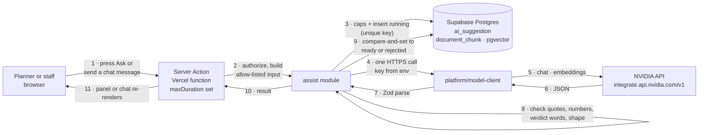

# TechDesign — AI Assist

**Feature:** F24 · new module `assist` · `src/platform/model-client.ts` · the section chat in `src/ui/phase/` · the profile panel
**Status:** Draft — revised 2026-10-22: the phase assist panel becomes the section chat with Explain and Change modes; a change stores a versioned report section
**Implementation:** Built in release 1; current as of 2026-10-24.
**Requirements:** [Requirements/ai-assist.md](../Requirements/ai-assist.md) (R1–R19)
**Builds on:** [research-phases.md](research-phases.md) (F21), [evidence-layers.md](evidence-layers.md) (F3), [evidence-review.md](evidence-review.md) (F19), [study-scoping.md](study-scoping.md) (F14), [jurisdiction-profile.md](jurisdiction-profile.md) (F1), [profile-upload-edit.md](profile-upload-edit.md) (F17), [provenance.md](provenance.md) (F4), [locked-report.md](locked-report.md) (F10)
**Decisions:** D27 (hosted inference and the assist boundary), D28 (hosting on Vercel and Supabase) in [alternatives-and-tradeoffs.md](alternatives-and-tradeoffs.md)
**Release:** 1, in three waves

## Approach

The model reads and quotes. The engine measures and decides nothing, and the model never touches what the engine produced. That is one rule, and everything below follows from it.

- **Beside, not inside.** A suggestion is stored in its own table, keyed to the phase output and the section content it was made on. It is never an input to the analysis or the engine fingerprint (R1). A section change is different: when the planner asks for one, UPlan stores its validated text as a new `report_section_version`; the engine output and every earlier version stay (R7, F21 R6). Deleting every suggestion changes nothing UPlan has computed.
- **Fixed shapes.** The model never writes free prose into the page. It fills a Zod-checked shape for one of eight kinds, and each shape has a place to put a quote. A model asked to "recommend" has nowhere to put it (R6).
- **Check, never repair.** Every output passes deterministic checks: exact quotes, numbers copied from the input, no verdict words, the shape. A failed output is recorded as rejected and shown as rejected. It is never trimmed, retried with hints, or sent to another model (R4–R6, R11).
- **Ask for it.** Nothing runs on load or save. A planner presses a button or sends a chat message on one phase for one subject (R9). A prompt filler fills the message box; it never sends.
- **Send little.** A typed builder assembles the request from allow-listed fields only, and the request as sent is stored (R8).
- **Serverless-shaped.** One request is one model call inside one function invocation. There is no queue, no worker, no in-memory state, so the feature works on Vercel with Supabase as the only state (D28).

**Rejected:** a conversational assistant over the whole project. It would need the project's details in context, it has no fixed shape to check, and it invites exactly the recommendation the charter forbids. **Rejected:** letting the model write the analysis draft. D26 stands: those are fixed templates over measurements. The section chat may rewrite the narrative **only when the planner asks for a change**, and the result is a version the planner adopted, never the draft (F21 R6, R2).

## Where it runs



The browser never sees the key, and never calls NVIDIA. Retrieval for Find runs in Supabase: the question is embedded once through NVIDIA (step 5), and the ranking is one SQL query over `document_chunk`, as D21 designed.

## Model roles

| Role | What it does | Candidate (verify in NVIDIA's catalog before pinning) | Pinned where |
| --- | --- | --- | --- |
| Generate | Fills one of the eight shapes from the supplied passages or measurements | `nvidia/nemotron-3-ultra-550b-a55b`, thinking off, with the checks enforcing the shape | A constant in `model-client.ts`, with its prompt version |
| Embed | Turns code chunks and questions into 1,024-dimension vectors for Find | `nvidia/nemotron-3-embed-1b` (since 2026-10-10; `nv-embedqa-e5-v5` was retired 2026-08-25). It returns 2,048 dimensions; the first 1,024 are kept and re-normalized, as its model card allows, so the `vector(1024)` column and index stand. The caller prefixes `query: ` or `passage: ` | A constant in `model-client.ts`; stored on every chunk |

- The endpoint is OpenAI-compatible, so `model-client.ts` uses `fetch` and Zod. No SDK is added.
- Model ids are constants, not settings: changing one is a pull request that must pass the evaluation set (R16).
- An embedding response whose length is not 1,024 is an error, not a truncation. A different dimension needs a migration and a re-embed, as D21 says.
- The catalog changes. A retired id fails explicitly and the panel says the model is unavailable (R11).

## What may be sent

The single rule behind R8, in a table. Only C1–C4, plus C5–C6 for the section chat, ever leave UPlan, and the builder is the only code that assembles a request.

| Class | Examples | Source in UPlan | Sent? |
| --- | --- | --- | --- |
| C1 Published code text | A section of the municipal code, an ordinance, a city checklist | `document_chunk.body` | Yes |
| C2 Dataset metadata | Title, publisher, publication date, abstract, lineage, use limitations, coverage name, license | `dataset`, `dataset_version` text fields | Yes |
| C3 Profile rules | Resource type labels, rule text, buffer widths, study names, citations | The pinned profile version | Yes |
| C4 De-identified results | Resource type, count, area in acres, distance in feet, ranges, gap reasons, limit sentences, dataset titles and vintages | `AnalysisResults` and a phase's drafted lines | Yes |
| C5 Section text (section chat only) | The section's headline, narrative lines, table captions, and fixed notices; maps reduced to title and description | The current section version or the analysis draft | Yes |
| C6 Instruction (section chat only) | The planner's chat message | The chat textarea, after the identity and email check | Yes |
| Project identity | Title, parcel or address, applicant, project manager, filing and decision dates | `decision` | **No** |
| Free text by a person | Resolution notes, profile change notes, change notes | `evidence_resolution`, `profile_change`, `report` | **No** |
| Geometry | Study area and footprint coordinates | `decision_geometry` | **No** |
| Files and people | Uploaded files, names, emails | Object storage, `app_user` | **No** |

How it is enforced:

- `assist/inputs.ts` has one builder per kind. Each returns a `.strict()` Zod object, so a field not in the schema is a compile error, and an extra key at runtime is a parse error.
- The section chat's instruction is free text, so `buildSectionInput` checks it before it is sent: it is refused if it contains the project's title, parcel or address, applicant, project manager, or any email address. The refusal names the reason and makes no model call.
- A test builds a project whose title, applicant, address, notes, and coordinates hold unique sentinel strings, runs every builder, and fails if any sentinel appears anywhere in the serialized request. A second test sends each of those sentinels in a chat instruction and asserts the builder refuses it.
- The stored `request` column is the proof: a reviewer sees exactly what was sent.
- NVIDIA is a third party that may log requests. Even the allowed classes are therefore public text or numbers with no identity attached.

## The eight kinds

| Kind | Shape (Zod, abridged) | Purpose | Effect |
| --- | --- | --- | --- |
| Explain | `{ paragraphs: [{ text, restates: lineRef[], quotes: Quote[] }] }` | Restate a drafted output or one row in plain language | None |
| Questions | `{ questions: [{ text, basis: { kind, ref }, quote? }] }` | Interrogative sentences, each tied to a gap, limit, range, or flagged row that already exists | None |
| Find | `{ found: true, passages: [{ sectionPath, quote }], gloss? }` or `{ found: false }` | Locate the exact passage that answers a question | None |
| Compare | `{ reasons: [{ reason, text, quotes }], notStated }` | Why two sources may differ, from their metadata alone | None |
| Metadata draft | `{ fields: [{ key, value, quote }] }` | Proposed dataset limitations and attributes | Staff confirm |
| Rule draft | `{ changes: [{ path, from, to, sectionPath, quote }] }` | Proposed profile rule changes | Staff confirm |
| Section explain | `{ paragraphs: [{ text, quotes: Quote[] }] }` | Answer a planner's question about one report section, quoting only what the section and its facts say | None |
| Section edit | `{ headline: string, lines: string[], tables: [{ key, caption, columnOrder }] }` | Rewrite the section's narrative on the planner's instruction | A new `report_section_version` |

`Quote` is `{ sourceId, text }`, where `sourceId` is one of the passage ids supplied in the request.

## Checks every output passes

Order matters: a cheap check that fails stops the rest, and the first failure is recorded with the later ones not run.

| # | Check | How | Requirement |
| --- | --- | --- | --- |
| K1 | Shape | `Schema.parse` of the raw response, `.strict()`. No repair, no defaults | R6 |
| K2 | Quotes exist | Each `quote.text`, with whitespace and hyphenation normalized, is a substring of the passage named by `sourceId`, which must be one of the passages sent | R4 |
| K3 | Numbers copied | Every digit run in every string field appears in the request's text or values, as the same string. The model may not round, sum, or convert | R5 |
| K4 | No verdict | A denylist, shared with `workflow/drafting.test.ts` and extended for questions: approve, deny, recommend, clear, safe, acceptable, no study, not needed, should, must, shall, condition | R6 |
| K5 | References exist | Every `lineRef`, `ref`, `sourceId`, and row id resolves to a record in the request | R4, R6 |
| K6 | Questions are questions | Each `questions[].text` ends in `?` and begins with an interrogative word, never `should`, `must`, `ensure`, or `require` | R6 |
| K7 | Size | A length cap per kind, in words | — |
| K8 | Profile validity (Rule draft only) | Apply `changes` to the base document; the result passes `ProfileDocumentSchema`, changes only paths a rule owns (never a planner-chosen setting), and each `to` value's numbers appear in its quote | R7 |
| K9 | Table formats (Section edit only) | Every `tables[].key` is a table the section prints, and `columnOrder` is a permutation of that table's canonical columns, so a provenance column can never be dropped; a caption passes K3 and K4 | F21 R2, R6 |

## Data model

One table of suggestions and one of responses, both append-only after a suggestion is final. They follow the pattern of `code_change_draft` in the data model.

```sql
create table ai_suggestion (
  id               uuid primary key default gen_random_uuid(),
  jurisdiction_id  uuid not null references jurisdiction (id),
  decision_id      uuid references decision (id),        -- null for city-level kinds
  phase            text not null check (phase in
                     ('profile','site','evidence','screening','studies','footprint','impact')),
  kind             text not null check (kind in
                     ('explain','questions','find','compare','metadata-draft','rule-draft',
                      'section-explain','section-edit')),
  subject_key      text not null,                        -- row id, study key, dataset version id, or '' for the whole phase
  output_sha256    text not null,                        -- the phase output (or profile or dataset version) this was made on
  section_sha256   text,                                 -- section chat: the section content hash it was made on (F21 R7)
  input_sha256     text not null,                        -- sha256 of canonical JSON of `request`
  model_id         text not null,
  prompt_version   integer not null check (prompt_version > 0),
  status           text not null check (status in ('running','ready','rejected','failed')),
  request          jsonb not null,                       -- exactly what was sent (R8)
  response_raw     jsonb,                                -- as returned, before any check
  content          jsonb,                                -- the validated shape; null unless ready
  check_failures   jsonb,                                -- [] unless rejected
  error_detail     text,                                 -- failed: HTTP status, timeout, rate limit, interrupted
  tokens_in        integer,
  tokens_out       integer,
  requested_by     text not null references app_user (id),
  started_at       timestamptz not null default now(),
  finished_at      timestamptz,
  check ((status = 'running') = (finished_at is null)),
  check (status <> 'ready'    or (content is not null and check_failures = '[]'::jsonb)),
  check (status <> 'rejected' or (response_raw is not null and jsonb_array_length(check_failures) > 0)),
  check (status <> 'failed'   or error_detail is not null)
);

-- R13: one live suggestion per output, kind, subject, and section. A failed one frees the key.
create unique index ai_suggestion_one_live
  on ai_suggestion (coalesce(decision_id, jurisdiction_id), phase, kind, subject_key, output_sha256,
                    coalesce(section_sha256, ''))
  where status <> 'failed';

create index ai_suggestion_usage on ai_suggestion (requested_by, started_at);
create index ai_suggestion_city_usage on ai_suggestion (jurisdiction_id, started_at);

create table ai_suggestion_response (
  id            uuid primary key default gen_random_uuid(),
  suggestion_id uuid not null references ai_suggestion (id),
  response      text not null check (response in
                  ('dismissed','helpful','not-helpful','confirmed','rejected')),
  note          text,
  profile_change_id uuid references profile_change (id),  -- set when staff confirmed a draft
  created_by    text not null references app_user (id),
  created_at    timestamptz not null default now()
);

grant select, insert, update on ai_suggestion to uplan_app;
grant select, insert on ai_suggestion_response to uplan_app;

create trigger ai_suggestion_final before update on ai_suggestion
  for each row when (old.status <> 'running') execute function forbid_final_row_change();
```

- `document_chunk` and `source_document` from F2's data model are reused for Find, with `embedding_model` holding the NVIDIA model id instead of a file hash. Supabase provides `pgvector`; the `vector(1024)` column and HNSW index are unchanged.
- A confirmed Rule draft or Metadata draft does not write to `profile_version` or the dataset directly. Staff confirmation calls the existing F17 path, which creates a `profile_change` with `source = 'code_change'` or the evidence module's attribute version, so every existing guard (approver is not the proposer, preview, effective date) applies. The response row links to it.
- `rule-draft` rows replace `code_change_draft` as the record of a draft's model call. `code_change_draft` stays the F2 record of the check results and proposal; its `generator_model` column holds the model id.

## Request lifecycle and consistency

1. **Authorize.** The Server Action authenticates and the module checks the actor owns the decision (or is staff, for city-level kinds). Nothing else decides access.
2. **Build.** The kind's builder reads the pinned records and returns the allow-listed request. The output fingerprint it was made on is read once, here, and used for the rest of the call (best-practices: never read "current" twice).
3. **Cap.** One statement counts the actor's and the city's rows started in the last 24 hours. At or above a cap, the call returns a `ConflictError` naming the cap. The count and the insert are one transaction, so two requests at once cannot both pass a cap of one.
4. **Claim.** `insert … on conflict do nothing returning *` takes the unique key. No row returned means a live suggestion exists: return it, and make no call (R13).
5. **Call.** One HTTPS call, with an `AbortSignal` shorter than the function's `maxDuration`. The transaction is closed before the call: the database holds no lock during network time.
6. **Check and finish.** Run K1–K9. `update … set status = 'ready' | 'rejected' | 'failed' … where id = $1 and status = 'running'` must affect one row, else `ConflictError`. For a Section edit, the same transaction calls `workflow.commitSectionChange`, which re-checks the section and output hashes and inserts the version; a `ConflictError` rolls the transaction back, and a separate update then marks the suggestion `failed` with that message, so no version exists without its suggestion and no suggestion claims a version that was not stored.
7. **Interrupted.** A function killed mid-call leaves a `running` row. There is no worker to sweep it. When a person requests the same key again and the row has been `running` for longer than the timeout plus a margin, the module marks it `failed` with `error_detail = 'interrupted'` by compare-and-set, which frees the unique key, and claims a new one.

| Failure | Recorded as | Shown to the person |
| --- | --- | --- |
| No `NVIDIA_API_KEY` | Nothing is written | "AI assist is not set up for this deployment." A true state, not a fallback |
| HTTP 4xx, 5xx, or a timeout | `failed`, with the status and the message | "The model service did not answer (reason). Try again." |
| HTTP 429 | `failed`, `error_detail = 'rate-limited'` | "The free model service is at its limit. Try again later." |
| Invalid JSON, or a failed K1–K8 | `rejected`, with every failed check | "The model's answer was rejected: (checks). Nothing from it is shown." The raw response is kept for staff and the evaluation set |
| A cap is reached | Nothing is written | "You have used N of N requests today. It resets at (time)." |

## Hosting on Vercel, Supabase, and NVIDIA

| Concern | Design |
| --- | --- |
| Where it runs | Server Actions and route handlers on Vercel. The route segment sets `export const maxDuration`, kept at or below the plan's limit. One model call per invocation, with the call's timeout set under it |
| Secrets | `NVIDIA_API_KEY` is a Vercel environment variable without the `NEXT_PUBLIC_` prefix, validated in `src/platform/env.ts` as optional (unset is a shown state) and never logged |
| Database | Supabase Postgres through the pooled connection string. Transactions are short and hold no session state, so transaction pooling is safe. `create extension vector` is run in a migration |
| No worker | Assist needs none. Nothing in this design uses graphile-worker, a timer, or in-process memory |
| Free-tier allowance | NVIDIA's hosted free access is for development and evaluation and is rate-limited; the live limit is shown in the NVIDIA account and is not assumed here. The caps (R12) are constants set below it |
| Concurrency across instances | Vercel runs many instances. Every guard above is a database constraint or compare-and-set; none is in memory |
| Data location | Requests leave to NVIDIA's service. Only classes C1–C4 are sent (R8), and nothing is sent that identifies a person or an application |

Caps, as starting constants to tune from NVIDIA's live limit and the first month of use:

| Cap | Starting value | Basis |
| --- | --- | --- |
| Per person per day | 40 requests | A planner working several projects: about five per phase on two projects |
| Per city per day | 400 requests | Dozens of planners, well under a free tier's minute-level rate limit |
| Find, extra | 1 embedding call per request | The question only; chunks are embedded when the code is indexed |

## Assist by phase

Legend. **Wave 1:** retrieval and explanation, planner-facing, display only. **Wave 2:** questions and comparison. **Wave 3:** staff-facing drafts. Every chat answer and suggestion is labeled AI-assisted where shown (R3); the report section is not (F21 R2). "Never" lists what the checks and shape make impossible, not just what the prompt asks.

### The section chat — all six phases

Every phase page has the chat beside its report section (F21 R16). It has two modes and two kinds; the phase-specific assists below are its **prompt fillers**, strongest first.

| Mode | Kind | Sent | Output | Gate | Effect |
| --- | --- | --- | --- | --- | --- |
| Explain | `section-explain`, or the kind of the filler the planner chose | C3/C4, C5, and C6 when the planner typed | A plain-language answer with quotes, or the filler's shape | K1–K7 | None; display only |
| Change | `section-edit` | C3/C4, C5, and C6 | `{ headline, lines, tables? }` | K1–K7, K9; then `commitSectionChange`'s hash check | A new `report_section_version` |

A filler fills the message box and sets the hidden `assistId`; it never sends. In Explain mode the filler's kind runs, and a free-typed question runs `section-explain`. In Change mode the filler text is an instruction and `section-edit` runs. Site and Footprint have no filler, only the two modes. The tables below list each phase's fillers; the chat itself is the same on every phase and is not repeated in each table.

### City profile (F1, F2, F17) — staff

| ID | Assist | Kind | Trigger | Sent | Model's task | Output | Gate | Wave |
| --- | --- | --- | --- | --- | --- | --- | --- | --- |
| PR1 | Draft a rule change from a changed code document | Rule draft | Staff presses **Draft** on a document that changed | C1: the changed sections plus the nearest unchanged ones by Find. C3: the current rule at each matched `sectionPath` | For each rule the section changes, propose the new field value with the exact words that say so | `changes[]` with `path`, `from`, `to`, `sectionPath`, `quote` | K1–K8. A person other than the requester confirms; F17's preview and approval then apply | 3 |
| PR2 | Find what the code says about a topic | Find | Staff or planner types a question on the profile page | C1: top chunks by retrieval, with the question | Return the passages that answer it | `passages[]` with quotes, or `found: false` | None; display only | 1 |

| ID | Checks specific to it | Never | Value to the user |
| --- | --- | --- | --- |
| PR1 | K8: only rule-owned paths; settings the planners chose (vesting, map status, records) are never in `changes`; each `to` number appears in its quote; an effective date is not proposed, staff set it | Applies itself; edits a setting; adds a rule with no quote; drafts text for a condition | Staff read the ordinance once, against a diff, instead of re-keying rules. This is where staff time goes today |
| PR2 | K2: every passage is a substring of a chunk sent; `found: false` is a valid and shown outcome | Answers from memory; paraphrases beyond the 60-word gloss; says what the rule means for a project | A planner or staff finds the controlling section in seconds, citing the same text a reviewer can open |

### 1 · Site

| ID | Assist | Kind | Trigger | Sent | Model's task | Output | Gate | Wave |
| --- | --- | --- | --- | --- | --- | --- | --- | --- |
| — | Section chat | Section explain, Section edit | Planner types a question or a change | C4: the study area's revision, area, source note, and sample flag. C5: the section text. C6: the instruction | Answer a question about the section, or rewrite its narrative | An answer, or a new section version | K1–K7, K9; the commit's hash check | 1 |

| Why no other assist | What serves the planner instead (not a model) |
| --- | --- |
| The boundary is the planner's own act, and its only inputs are a map and a site plan the model cannot be given: coordinates are not sent (R8) and the plan is an applicant document. There is no public text to read. | Drawing, GeoJSON upload with a stated rejection reason, and sample data (F21 R12, F23). A parcel or address lookup from public records is a data feature, not a model. The chat can explain the section's wording and rewrite its narrative on request. |

### 2 · Evidence

| ID | Assist | Kind | Trigger | Sent | Model's task | Output | Gate | Wave |
| --- | --- | --- | --- | --- | --- | --- | --- | --- |
| EV1 | Explain the evidence in plain language | Explain | Planner presses **Explain this evidence** | C4: the phase's drafted lines, the resource labels, and each dataset's title, vintage, and limitation text | Restate each drafted line for a reader who is not a GIS analyst, citing the line it restates | `paragraphs[]` with `restates` line refs | None; display only | 1 |
| EV2 | Explain why two sources may differ | Compare | Planner presses **Why might these differ?** on a disagreement row | C2: both datasets' metadata. C4: the measured difference | List reasons the metadata supports: vintage, scale, definition, coverage, method. Say what the metadata does not state | `reasons[]` with quotes, and `notStated` | None; the F19 reliance control beside it is unchanged | 2 |
| EV3 | Draft a dataset's limitations and attributes | Metadata draft | Staff presses **Draft from metadata** when a dataset version is ready | C2: the publisher's metadata text | Propose limitation statements and values for vintage, scale, and method, each from a quote | `fields[]` with `key`, `value`, `quote` | Staff confirm; creates a new attribute version through `evidence` | 2 |

| ID | Checks specific to it | Never | Value to the user |
| --- | --- | --- | --- |
| EV1 | K3: every number is a verbatim copy from the lines restated; K5: each `restates` ref is a real line; length cap 150 words per paragraph | Adds a figure or a finding; says a gap does not matter; lessens a limit sentence | A planner can hand the commission's reader a paragraph they understand, without the gaps disappearing. The fixed limit sentences stay on the page beside it |
| EV2 | K2: every reason has a quote from one of the two metadata texts; `reason: 'unknown'` is allowed and shown | Says which source is right; ranks the sources; fills a missing vintage by guess | Disagreement becomes a question about two named facts a planner can check, which is what F19 asks them to record |
| EV3 | A field with no quote is not emitted, and the page shows "not stated" for it. K2 on every value; K3 on numbers | Sets the dataset's confidence level; sets coverage; changes geometry or features | Dataset limitations are written once, correctly, by staff, and every project that uses the dataset shows them (P1) |

### 3 · Screening

| ID | Assist | Kind | Trigger | Sent | Model's task | Output | Gate | Wave |
| --- | --- | --- | --- | --- | --- | --- | --- | --- |
| SC1 | Explain a screening row, with the rule quoted | Explain | Planner presses **Explain** on a row | C3: the row's resource, the rule's text, buffer, and citation. C4: the row's template text and its dataset limitation | Say in plain words what the row's wording and the quoted rule mean together | One paragraph with `quotes[]` of the rule and the limitation | None; display only | 1 |
| SC2 | Suggest what a desk screen can't see | Questions | Planner presses **What might this screen miss?** | C4: the run's recorded gaps and limit sentences, the flagged resource types, and resource types with no mapped dataset | Turn each recorded gap or limit into a concrete field-check question for this set of resources | `questions[]`, each with `basis` pointing to a gap, limit, or flagged row id | None; display only | 2 |
| SC3 | Find the passage behind a flag | Find | Planner presses **Where does the code say this?** | C1: the top chunks for the rule's citation and the resource's name | Return the passage that sets the buffer or the trigger | `passages[]` or `found: false` | None; display only | 1 |

| ID | Checks specific to it | Never | Value to the user |
| --- | --- | --- | --- |
| SC1 | K2 on the rule quote; K4; the fixed notice "A desk screen can't see…" is rendered by the page, not the model, so the model cannot drop it | Says the row is or is not a concern; says no study is needed; turns "no mapped wetlands" into "none exist" (P2) | A new planner or a resident-facing colleague understands a row without reading the code, and the rule is one click away |
| SC2 | K5: each `basis.ref` is an existing gap, limit, or flagged row. K6: each ends in `?`. The model cannot raise a topic that has no record | Asserts that a resource is present; says a field visit is or is not required; lists a study by name (that is Studies') | The screen's blind spots become a checklist for a site visit, which is where the charter says a desk screen's gap is |
| SC3 | K2 only; `found: false` is shown plainly | Interprets the passage; applies it to the project | The citation behind a flag, on the page, without a search |

### 4 · Studies

| ID | Assist | Kind | Trigger | Sent | Model's task | Output | Gate | Wave |
| --- | --- | --- | --- | --- | --- | --- | --- | --- |
| ST1 | Find why a study is listed | Find | Planner presses **Why is this study listed?** on a study row | C3: the study's name and the rule that names it. C1: top chunks for that rule and the city's checklist text | Return the passage that names the study and the checklist line it appears on | `passages[]` or `found: false` | None; display only | 1 |
| ST2 | Draft questions for the pre-application conference | Questions | Planner presses **Questions for the conference** | C4: the flagged studies, the rows that triggered each, and the recorded gaps | For each flagged study, ask what information would show whether the flagged resource is on or near the site | `questions[]` with `study`, `triggeredBy` row id | None; the planner copies what they choose | 2 |
| ST3 | Compare flagged studies with the city's checklist | Compare | Staff presses **Compare with the checklist** for an application type | C1: the checklist text for that type. C3: the studies the engine would flag for it | List a study that is in one and not the other, with the quote | `differences[]` with `study`, `inEngine`, `inChecklist`, `quote` | Staff only; a difference may start an F17 change, never applies one | 3 |

| ID | Checks specific to it | Never | Value to the user |
| --- | --- | --- | --- |
| ST1 | K2 on both passages; the study list itself is the engine's and is not an input the model can change | Adds or removes a study; says a study is not needed (P2); drafts what an applicant must submit | A planner can cite the exact sentence that triggers a geotechnical or arborist report to an applicant or an attorney |
| ST2 | K5: each `triggeredBy` is a real flagged row. K6: no `should`, `must`, `require`. A question is about information, never a requirement | Proposes a condition of approval (charter); states what the applicant must do; ranks questions | The conference is where the charter says screening is used. A planner arrives with questions tied to specific flags instead of starting from a blank page |
| ST3 | `differences` may be empty and is then shown as "no differences found in this text", with the K2 limit that this reads one document | Edits the engine's list or the profile | Catches a profile that has drifted from the city's checklist before it misleads an application |

### 5 · Footprint

| ID | Assist | Kind | Trigger | Sent | Model's task | Output | Gate | Wave |
| --- | --- | --- | --- | --- | --- | --- | --- | --- |
| — | Section chat | Section explain, Section edit | Planner types a question or a change | C4: the footprint's revision, area, source note, and sample flag. C5: the section text. C6: the instruction | Answer a question about the section, or rewrite its narrative | An answer, or a new section version | K1–K7, K9; the commit's hash check | 1 |

| Why no other assist | What serves the planner instead (not a model) |
| --- | --- |
| The footprint is the proposal under evaluation, traced from an applicant's site plan. Reading the plan would send an applicant document to a third party (R8), and a model's trace has no accuracy the planner could rely on. A footprint produced by a model would also make the impact numbers a function of a guess, which the charter's pilot edge cannot carry. | Drawing, GeoJSON upload with a stated rejection reason, and sample data. The area is PostGIS's, immediately. The chat can explain the section's wording and rewrite its narrative on request. |

### 6 · Impact

| ID | Assist | Kind | Trigger | Sent | Model's task | Output | Gate | Wave |
| --- | --- | --- | --- | --- | --- | --- | --- | --- |
| IM1 | Explain the impact table in plain language | Explain | Planner presses **Explain this impact** | C4: each impact row (resource, area, length or count, units, range) as the formatted strings shown, plus the limit sentences | Restate each row for a reader who has not seen the table, copying its figures | `paragraphs[]` with `restates` row refs | None; display only | 1 |
| IM2 | Name what would narrow a range | Questions | Planner presses **What would narrow this range?** on a range row | C3: the rule and the field-rated attribute it depends on. C4: the range and its two ends | Ask what field-rated fact decides which end applies | `questions[]` with `basis.ref` the range row | None; display only | 2 |
| IM3 | Find where a buffer is set | Find | Planner presses **Where does the code set this width?** | C1: top chunks for the rule's citation | Return the passage that sets it | `passages[]` or `found: false` | None; display only | 1 |

| ID | Checks specific to it | Never | Value to the user |
| --- | --- | --- | --- |
| IM1 | K3 is strict here: a number must equal a formatted string from the table, so the model cannot round, sum, or convert (acres to square feet). The limit sentences are shown by the page, unchanged | Says an impact is large, small, acceptable, or avoidable; compares resources; leaves out a range's other end | The pilot's edge is the impact; this makes it readable by the people who must decide on it, without a second hand re-typing numbers |
| IM2 | K5: each question references a real range row. A range's two ends are never merged into one value | Assumes a wetland category; says which end is likely; proposes a study | The charter says never assume a field-rated attribute. The model turns that rule into the exact question to ask in the field |
| IM3 | K2 only | Interprets the width for the project | The citation behind a number, one click away, as P1 expects |

### 7 · Overview and 8 · Report

| Page | Model use | Why none | What serves the planner instead (not a model) |
| --- | --- | --- | --- |
| Overview | None | It states where the research stands. A summary written by a model could be wrong about state, and the state is already derived from records (F18). | Next actions, counts, and the stage rail, all derived |
| Report | None in the document | P3: the document is built from pinned records and is locked, hashed, and quotable out of context. A model sentence enters it only as a section version the planner asked for and adopted (F21 R6); the document does not label it AI-assisted, because it is the planner's adopted text | The finish checklist, version history, and download, unchanged |

## Considered and not selected

| Idea | Why not |
| --- | --- |
| Extract project details from an applicant's PDF | An applicant document is third-party data and personal data (R8); applicant-submitted material is not evidence (charter); an extraction error would sit in a project's identity |
| Read a site plan and draft the footprint | Same privacy objection, no georeferencing a planner could trust, and the number it produces would drive the impact |
| A model that flags resources or study needs | That is the screen. P2 requires a deterministic, testable screen. A model's miss would read as a clearance |
| A summary or cover note inside the document | P3 and R2 |
| Chat over the whole project | No fixed shape to check; needs project identity in context (R8); invites a recommendation |
| Automatically apply a confirmed rule draft | Staff confirmation is the control (R7); F17's approval and preview are the path |
| Another model as a fallback when the first fails | A fallback mechanism; best-practices forbids it. A failure is shown |
| A model rewriting a section without the planner asking | The section is the planner's adopted text, and an automatic rewrite would change the report between versions. Change mode runs only on the planner's instruction and stores a version (F21 R6) |
| A model rewriting a figure, table value, quote, list, or notice while rewriting narrative | Those are locked by the shape, K3, and K9; the section's numbers come from the analysis, and the model's output has no field for them |

## Requirement coverage

| Req | Satisfied by | Notes |
| --- | --- | --- |
| R1 | `ai_suggestion` is a separate table; no analysis or fingerprint code reads it. A section version is separate from the output and its fingerprint | A test deletes every suggestion and asserts byte-identical analysis drafts; `commitSectionChange` writes no analysis row |
| R2 | `reports` builds only from the snapshot; a change enters only as a version the planner asked for | Lint boundary: `reports` cannot import `assist` or `workflow` |
| R3 | The chat renders the label from the row's `model_id` and `finished_at`; exports include it; the section itself is unlabeled | One component, so no suggestion renders without its label |
| R4 | K2, K5 | Substring match after normalization; reject, never repair |
| R5 | K3 | |
| R6 | Shapes, K1, K4, K6 | The denylist test is shared with the drafting templates |
| R7 | `ai_suggestion_response.confirmed` creates an F17 change; a Section edit stores a version through `commitSectionChange` | Display kinds have no write path; a version never changes the output |
| R8 | `assist/inputs.ts` builders; the sentinel test; the instruction check; stored `request` | |
| R9 | Server Action only, on a button or a chat send; fillers never send; no page-load call and no cron | |
| R10 | `output_sha256` and `section_sha256` compared with the current records on render and at commit | "Out of date" label with the reason |
| R11 | The failure table; no fallback code path | Failure tests for each row of it |
| R12 | Cap query and insert in one transaction | Race test: two requests at the cap |
| R13 | `ai_suggestion_one_live` partial unique index; `insert … on conflict` | Race test: two identical requests, one call |
| R14 | `ai_suggestion_response` | |
| R15 | Panel built from React Aria; `aria-live` for status; text and shape for states | axe in the phase-page specs |
| R16 | `eval:assist` evaluation suite, defined when the feature is built | Includes planted invented numbers, verdict-bearing outputs, and missing quotes |
| R17 | F16 retention covers both tables | Export includes `request`, `model_id`, `prompt_version` |
| R18 | The phase tables above | Site and Footprint have the section chat only |
| R19 | `SectionChat` inside `ReportSectionPanel`; `PHASE_PROMPTS` fillers | Visible beside the section; fillers never send |

## Risks and tradeoffs

- **Free access terms and availability.** NVIDIA's hosted free access is intended for development and evaluation, is rate-limited, and models in its catalog are retired. A city pilot may not be a permitted use. Mitigation: the feature is optional (unset key is a shown state), model ids are pinned and tested, and nothing in the analysis depends on it. **Confirm the terms before the city uses it.**
- **A third party sees requests.** The allow-list keeps identity out, and the stored request is auditable. Code text, dataset metadata, and measured numbers are public or de-identified, but a number tied to a distinctive site could still be recognizable. That is accepted for the pilot and is why geometry, parcel, and dates are excluded.
- **Prompt injection in retrieved text.** A code document or dataset abstract could contain instructions. The model has no tools and no write path, its output has a fixed shape, and every statement is checked against the supplied text, so the worst case is a rejected or misleading display-only suggestion. Passages are sent inside a delimited data block that the system prompt marks as untrusted.
- **Quote checking is brittle.** Hyphenation, ligatures, and PDF line breaks can make a true quote fail. Normalization handles whitespace and hyphenation; the cost of a false rejection is a visible rejection, which is the correct side to err on.
- **The numbers rule rejects helpful rounding.** "About 2 acres" for 1.84 acres is rejected. The cost is plainer text; the benefit is that a figure a model produced can never differ from the table.
- **Non-determinism.** Same input, different output, so a suggestion is stored and shown as stored, never regenerated silently (R10). Sampling follows the model card (temperature 1.0, top_p 0.95), so variation is expected; the checks are what keep an answer safe to show.
- **Latency on serverless.** A 70B model can take tens of seconds. The call has a hard timeout, the panel shows progress, and a timed-out request is a shown failure.
- **Planner over-trust.** A well-written explanation may be read as authority. Every suggestion carries its label, its quotes, and the fixed sentence that it is not part of the analysis. A "not helpful" response feeds the evaluation set.

## Verification

- **Unit:** each builder (sentinel test), each check K1–K8 with passing and failing fixtures, the denylist over every kind's shape, and the formatter of labels.
- **Integration (Testcontainers):** the cap and unique-key races, the interrupted-row path, the append-only triggers, and that confirming a draft produces a `profile_change` and never a `profile_version`.
- **Recorded responses:** tests of model-dependent code use recorded NVIDIA responses beside the test; only the evaluation suite calls the real service.
- **End-to-end:** a phase page with a suggestion, a rejected suggestion, a failed one, and an out-of-date one, each with its axe check and a phone-width view.
- **Evaluation suite:** golden questions with expected quotes and planted failures. A change to a model id, prompt, chunking, or retrieval query ships only if no metric gets worse.

## As built (2026-10-10)

Everything above was built, in all three waves. These are the places the code differs from the design text, so the two agree.

| Topic | Design said | As built | Why |
| --- | --- | --- | --- |
| Generation model | A candidate list | `nvidia/nemotron-3-ultra-550b-a55b` (chosen by the project owner, 2026-10-10, after the earlier Llama and Nemotron 3.5 Lightning picks), a constant in `platform/model-client.ts`. Thinking off (`chat_template_kwargs.enable_thinking: false`), temperature 1.0 and top_p 0.95 as the model card recommends, no `guided_json` | A 550B mixture-of-experts reasoning model with 55B active parameters on the free API; a slow one, so the call timeout (45 s) may be reached. Thinking is off because every assist fills a fixed shape from supplied text and reasoning tokens would spend the free allowance. The checks, not the decoder, enforce the shape. Chosen unmeasured: run `npm run eval:assist` with a key before relying on it |
| Output parsing | Zod parse of the raw response | The same, and exactly one wrapping markdown fence is stripped. Any other prose around the JSON is a K1 rejection | A fence is formatting, not content |
| `ai_suggestion.assist_id` | Not a column | Added. The unique key is `(coalesce(decision_id, jurisdiction_id), assist_id, subject_key, output_sha256)` where `status <> 'failed'` | Two assists of one kind (`SC1` and `SC3` are Explain and Find; `EV2` and `ST3` are both Compare) must not share a key |
| `ai_suggestion.input_sha256` | `not null` | Nullable while `running`, required for `ready` | The row claims the unique key before retrieval, so a double submission makes one call (R13). The request is written when it has been assembled |
| `ai_suggestion.response_raw` | `jsonb` | `text` | The model's reply may not be JSON, and K1 must be able to keep it |
| Claiming a row | Cap, then claim | One transaction: advisory locks on the person and the city, then the live-row lookup, the stale-row release, the two counts, and the insert | Serializes the count and the insert without a table lock, and works through Supabase's transaction pooler |
| `source_document` and `document_chunk` | Belonged to F2's `code_source` and `code_check` | Standalone: `jurisdiction_id`, `kind` (`code` or `checklist`), `title`, `content_sha256`, `embedding_model`, `chunk_count`, `created_by`. No raw object, no `search_text`, no status. Write-once by trigger | There is no code-fetch pipeline yet. Staff paste text, which is chunked at section numbers and embedded in the same request |
| One confirmation | A check in code | `ai_suggestion_one_confirmation`, a unique partial index on `ai_suggestion_response (suggestion_id) where response = 'confirmed'` | A one-at-a-time rule is a constraint (best-practices) |
| Confirming a rule draft | `source = 'code_change'` through F17 | `profiles.applyDraftedChange`, in the confirmer's transaction with the response row: `proposed_by` is the requester, `decided_by` the confirmer, source `code_change`. The profile pointer is moved under the city's row lock with the base version compared | F17 applies at once (R5, 2026-10-04); the second-person rule is F24's own |
| What a rule draft can change | "rule-owned paths" | A number of an existing rule: `bufferRules.<key>.widthFt`, `studyTriggers.<key>.withinFt`, `treeRules.<key>.minDbhIn`, `.maxCount`, `.periodYears`. Never a setting, a date, or a new or removed rule. Staff enter the effective date and the ordinance; the rule in force ends that day and a new entry starts | A date is staff's act (PR1 _Never_), and the profile already versions a rule by date |
| Confirming a metadata draft | A new attribute version | A compare-and-set of `dataset.known_limitation` from the value the draft was made against, in one transaction with the response row, which records the previous text. Only the limitation is a stored field; vintage, scale, and method are shown, not written | There is no versioned attribute table to write to. Making one is an `evidence` change of its own |
| Retrieval | `document_chunk` ranked by cosine, per rule | `retrieveCodePassages`: one embedding call for all queries, one nearest-neighbour query each in one transaction with `hnsw.iterative_scan = relaxed_order`, de-duplicated and capped (4 for a row, 6 for a question, 12 for a rule draft) | Keeps one request to one embedding call and one chat call |
| ST3 and EV3 inputs | Not specified | ST3 compares the profile's named studies with a `checklist` document staff added. EV3 takes the publisher's metadata text staff paste (12,000 characters) | No source for either exists on this target |
| Records export (R17) | Both tables in F16's export | A project's suggestions are exported with its `decision` records and the city-level ones with `profile-change` records, each row carrying `request`, `model_id`, and `prompt_version` | F16's record types are a closed list in every profile's settings, so a new type would change every profile document |
| Evaluation set (R16) | Defined when built | `npm run eval:assist`: planted failures run offline and must each be rejected; golden questions run against the real service when a key is set | |
| Panel placement (R19) | The panel sat beside the drafted output | Before 2026-10-22 the panel was the first block, a `spotlight` with the strongest assist. From 2026-10-22 the **section chat** is inside the section panel, beside the section, and the spotlight is removed. The /profile panel keeps the accordion | The section and its chat are one block, and a change is stored as a section version |
| Section chat (2026-10-22) | Not in the first build | New kinds `section-explain` and `section-edit`, a `section_sha256` binding, and `commitSectionChange` called in the suggestion's finalize transaction; `PHASE_PROMPTS` fillers; the phase spotlight and the old feedback box removed | F21's refactor replaced reviews and feedback with versioned sections |

## Open items

- **Hosting.** This design needs only Vercel and Supabase. The rest of release 1 runs on one managed worker container (D29) for graphile-worker, Chromium, and GDAL. A Vercel-native replacement using Queues and Workflows is designed in [deployment-guide.md](deployment-guide.md), Part E, but is not the current deployment.
- **Where code text comes from.** _Decided and built:_ staff paste the city's code text or a checklist on the profile page, up to 150,000 characters at a time. It is chunked at section numbers, embedded, and written once. F2's fetch-and-index (Poppler and a worker) is a later step.
- **NVIDIA terms** for a city pilot, as above.
- **The model id.** Pinned to `nvidia/nemotron-3-ultra-550b-a55b` in `platform/model-client.ts`. The 2026-10-16 tests timed out on some generation calls, so changing the id requires a fresh run of `npm run eval:assist`; embeddings answer in about 0.5 s.
- **Whether Find belongs on the dashboard** as a city-level question box. It would be PR2 without a project, with the same rules.
