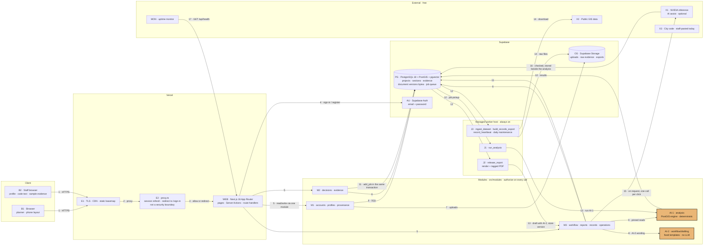
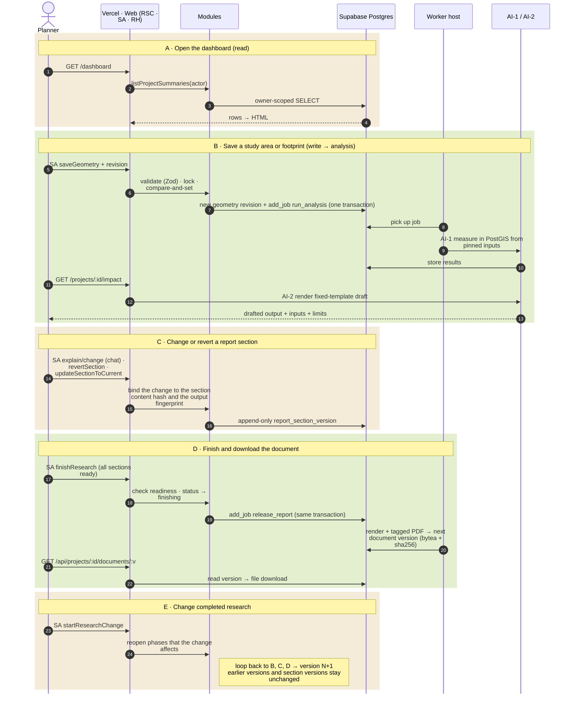

# UPlan — Application Architecture Diagram

**Status:** Current as of 2026-10-24 — a one-page visual map of the application, its deployment, and where automation and AI sit.
**Last updated:** 2026-10-24
**Implementation:** Current build and deployment; F2 and the later features are not drawn as built.
**Related:** [system-architecture.md](system-architecture.md) (deployment, jobs, budget) · [deployment-guide.md](deployment-guide.md) (Vercel + Supabase + worker) · [research-phases.md](research-phases.md) (phase drafting) · [project-dashboard.md](project-dashboard.md) (pages) · [data-model.md](data-model.md)

This page shows how a request travels through UPlan and marks every place that does automated work. It adds no design of its own: where it and another TechDesign doc disagree, the other doc wins and this page is wrong.

## Read this first: what "AI" means in UPlan

| Tag | What it is | Is it a language model? | Status |
| --- | --- | --- | --- |
| **AI-1** | **Analysis engine** (`analysis`, worker job `run_analysis`): measures areas, buffers, and overlaps in PostGIS from pinned inputs | No. Deterministic SQL | Built |
| **AI-2** | **Phase drafting** (`workflow/drafting.ts`): turns the measured numbers into a headline and plain sentences using fixed templates | No. Fixed wording; a test fails on any verdict-shaped word | Built |
| **AI-3** | **AI assist** (F24, module `assist`): on request, explains, finds passages, asks questions, compares sources, rewrites a section narrative, and drafts profile rules or dataset notes for staff. Calls NVIDIA's hosted API from a Server Action | **Yes.** Hosted open models, with only allow-listed text and de-identified measurements sent | Built |

UPlan never uses a model to write findings, recommendations, conditions, a number, a flag, or any sentence of a phase output or the released document. AI-3 reads and quotes, sits beside the analysis, is requested by a person, and for rule and dataset drafts waits for a different staff member to confirm. See [ai-assist.md](ai-assist.md).

## Diagram 1 — System map

Boxes are grouped by layer. Arrows point from the part that starts the exchange. Gold boxes are AI-1, AI-2, and AI-3.

## Diagram 2 — Request routes

Each row is one route a person or a monitor can hit. Every route ends in a module function that checks access itself.

## Route table

| Kind | Route | Auth | Calls | Result |
| --- | --- | --- | --- | --- |
| Page | `/` | Public | none | Landing |
| Page | `/sign-in`, `/register` | Public | SA → AU | Session cookie |
| RH | `/auth/callback` | Public | AU | Confirms an emailed link |
| Page | `/dashboard` | Signed in | `workflow`, `profiles` | Current and completed research, city profile |
| Page | `/projects`, `/projects/new` | Signed in | `workflow`, `decisions` | List; create form |
| Page | `/projects/:id/overview … /report` | Owner only | `workflow`, `analysis`, `reports` | Eight project pages, each with its report section, chat, inputs, and data |
| Page | `/profile`, `/help` | Signed in | `profiles` | City rules and settings; guidance |
| SA | project actions | Owner only | `decisions`, `workflow`, `reports`, `assist` | Create, sample, delete, details, geometry, section chat, revert, finish, research change |
| SA | profile actions | Signed in; staff for drafts | `profiles`, `assist` | Upload, settings, sources, code text, sample evidence, AI-draft confirmation |
| RH | `/api/projects/:id/documents/:v` | Owner only | `reports` | Document version download |
| RH | `/api/tiles/:version/:z/:x/:y` | Public path, no project data | `evidence` | Vector tile from PostGIS |
| RH | `/api/profile/template` | Signed in | `profiles` | Excel template |
| RH | `/api/health` | Public | `operations` | Database, worker heartbeat, and job checks |

## Key

### Abbreviations

| Short | Meaning |
| --- | --- |
| RSC | React Server Component: a page that renders on the server |
| SA | Server Action (Server Function): a form or button that writes |
| RH | Route handler: an `/api/…` or `/auth/…` endpoint |
| PG | PostgreSQL with PostGIS and pgvector: the one database |
| OS | Supabase Storage, through its S3-compatible API |
| AI-1 / AI-2 / AI-3 | The three automated parts described above |

### Boxes

| Box | Meaning |
| --- | --- |
| B1 | A planner's browser. The layout is responsive; a dedicated read-only phone mode is later. |
| B2 | UPlan staff in a browser: manage the profile, code text, sample evidence, and AI drafts. |
| E1 | Vercel's edge: TLS, CDN, static files, and the basemap. |
| E2 | `proxy.ts`: refreshes the session and redirects signed-out visits. A convenience, not security. |
| WEB | The Next.js app: pages, Server Actions, and route handlers. Stateless. |
| M1 | Sign-in wiring, city profile and rules, the provenance formatter. |
| M2 | Projects (decisions), study areas and footprints, evidence datasets. |
| M3 | Phases and sections, the document, records, health, and AI suggestions. |
| AI-1 | **AI.** The analysis engine: PostGIS measurements, same inputs give the same results. Not a language model. |
| AI-2 | **AI.** Phase drafting: fixed sentence templates over the measured numbers. Not a language model. |
| AI-3 | **AI.** AI assist: hosted models reached through one server-side client. Suggestions are labeled, quote their source, and are stored beside the analysis. Section edits create a version. |
| J1 | Job `run_analysis`: runs AI-1 for one project. |
| J2 | Job `release_report`: renders the document and stores the next version. |
| J3 | The other jobs: dataset ingest, records export, heartbeat, daily maintenance. |
| PG | Holds projects, report sections, evidence, document versions (bytea with sha256), and the job queue. |
| OS | Holds uploads, raw evidence, and exports. Documents are **not** here. |
| AU | Supabase Auth: email and password. |
| X1 | NVIDIA inference: optional AI assist. |
| X2 | Free public GIS data that J3 downloads. |
| X3 | City code that staff paste for the Find assist; automatic fetching is not built. |

### Arrows

| Arrow | Meaning |
| --- | --- |
| Solid line | A call that happens while the app is in use |
| Dotted line | A hand-off that needs a person, here a staff confirmation, before it has effect |
| Number on a line | The order along that path in Diagram 1. Several lines can share a number when they are alternatives |
| Gold box | Automated drafting or analysis (AI-1, AI-2, AI-3) |
| Steps 1–3 | Request reaches Vercel, passes the session check, lands on a page or route |
| Steps 4–9 | Page or action calls one module, which reads or writes PG (and OS for uploads) |
| Steps 10–11 | A module asks AI-1 for pinned measurements; results are stored; a write queues its job in the same transaction |
| Steps 12–14 | The worker picks up the job and runs AI-1, document rendering, or ingest |
| Step 15–16 | A planner presses a button; the module sends one allow-listed request, checks the answer, and stores it beside the analysis |
| Step 17 | An external monitor checks the health endpoint |

### Rules the diagram shows

- **Authorization is in the modules**, not `proxy.ts` (E2).
- **Slow work is a job.** A write adds its job in the same transaction, so a job never exists without its change.
- **Documents live in PG.** Each version is stored once with a hash and never edited; a research change adds a new version.
- **No language model writes findings.** AI-1 and AI-2 are deterministic; AI-3 reads, quotes, and asks, and its rule and dataset drafts take effect only after staff confirmation.
- **Hosting.** Vercel serves the web app, Supabase holds data/auth/files, and one managed worker container runs Chromium, GDAL, and graphile-worker. A Vercel-native worker is designed in [deployment-guide.md](deployment-guide.md), Part E, but is not the current deployment.
