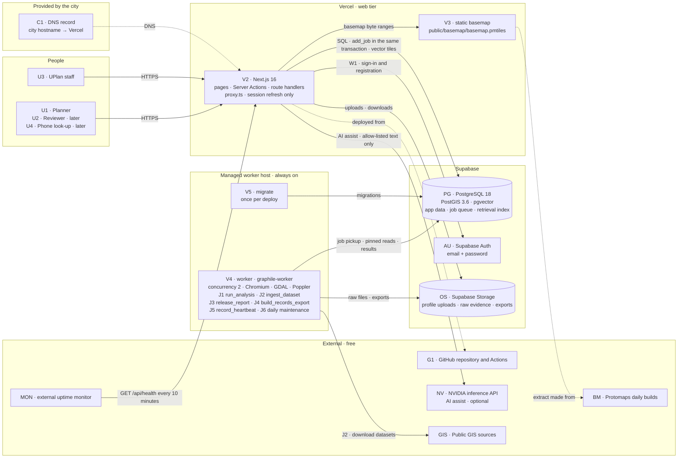
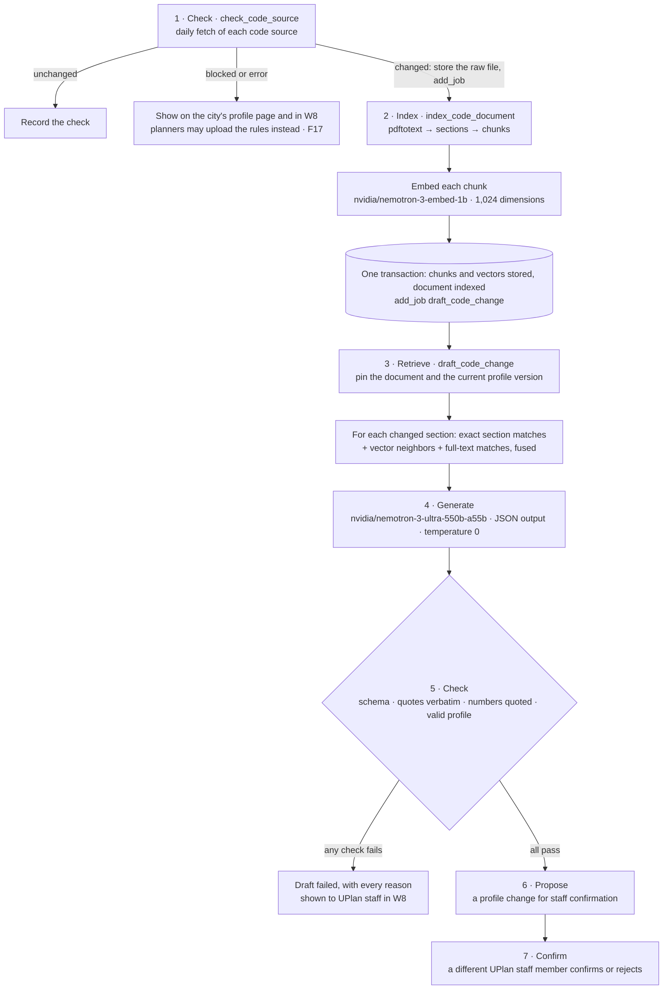

# UPlan — System Architecture

**Status:** Current as of 2026-10-24 — system-level technical design; deployment is Vercel + Supabase + one managed worker container
**Last updated:** 2026-10-24
**Implementation:** Current build and deployment; features marked not built are design only.
**Derived from:** [charter.md](../Requirements/charter.md), [intents.md](../Requirements/intents.md), [features.md](../Requirements/features.md)
**Related:** [tech-stack.md](tech-stack.md) · [data-model.md](data-model.md) · [alternatives-and-tradeoffs.md](alternatives-and-tradeoffs.md)

This document sets the shape every feature's TechDesign doc builds on. A feature doc adds detail; it doesn't contradict this document without changing it first.

## Update, 2026-10-24: the current deployment

This document describes the application as it is built and deployed today.

| Decision | What it changes here | Record |
| --- | --- | --- |
| **Web on Vercel, data/sign-in/files on Supabase** | Vercel hosts the Next.js pages, Server Actions, and route handlers. Supabase provides PostgreSQL 18 with PostGIS 3.6 and pgvector, Supabase Auth, and Storage through its S3-compatible endpoint. The Caddy, `postgres`, `migrate`, backup-timer, and deploy-script containers are no longer part of the target. | D28 |
| **One managed worker container** | graphile-worker, Chromium, GDAL, and Poppler run in the existing `worker` image on an always-on container host (Render, Railway, Fly.io, Cloud Run with a minimum instance, or the existing Oracle VM). The worker connects to the same Supabase database over a session/direct connection. This is the current, working deployment. | D29 |
| **AI assist on NVIDIA hosted inference** | The `models` container, Hugging Face model files, and llama.cpp are replaced by calls from `src/platform/model-client.ts` to NVIDIA's API. A new module, `assist`, owns every other model use. | D27 |

**Why the worker is not a Vercel Function.** graphile-worker keeps a long-lived PostgreSQL connection and listens for jobs; Vercel Functions scale to zero when no request arrives. The worker also needs a full browser for tagged PDFs and GDAL for public-data ingestion. Vercel's own guidance is to keep this shape on an always-on host and connect it through a shared database or queue. The database is already the queue, so the worker needs no new broker.

A Vercel-native replacement using Vercel Queues and Workflows is designed in [deployment-guide.md](deployment-guide.md), Part E. It requires replacing graphile-worker, Chromium, and GDAL in code, so it is the migration path, not the current deployment.

## Constraints

- **Zero cost where possible.** Every service is open-source software or a free tier used within its limits (see _Free-tier budget_). There is no paid API. A city pilot may need Vercel Pro for commercial use and longer functions; that is a hosting-plan decision, not a paid API. NVIDIA's free hosted inference is the one model service _(D27)_.
- **Few external services.** Vercel hosts the application, Supabase provides the database, sign-in, and files, NVIDIA's inference API serves the AI assist, and one managed worker host runs the background jobs. GitHub hosts the code. Public data is downloaded from free public sources.
- **Minimal configuration.** One repository deploys to Vercel, one Supabase project holds the data, and one worker container runs the jobs. The worker is the only always-on process; the web tier is stateless.
- **Sized for the hosting plans.** Vercel Functions fit the plan's duration and memory limits, the Supabase database fits its plan, and the worker container fits a small always-on host (2 OCPUs / 4–8 GB is ample for a pilot).

## Assumptions for open product questions

Round 10 is unanswered. The design follows the recommended options, and each one is contained so that a different answer changes one module, not the schema.

| Open question                          | Assumed                                                                               | If the answer differs                                                                                     |
| -------------------------------------- | ------------------------------------------------------------------------------------- | --------------------------------------------------------------------------------------------------------- |
| What a vesting setting does            | A rule set marked as vesting uses the rules in force on the application's filing date | _Warn only:_ `rulesInForce` runs for both dates and the run flags the differences                         |
| Who approves profile uploads and edits | A planner's upload or settings edit applies at once; an AI-drafted rule or metadata change is confirmed by a different UPlan staff member | _A city reviewer:_ returns with F12's per-project or per-city grant. _No confirmation:_ the change applies at submit |
| Cities beyond Sammamish in v1          | Sammamish is the pilot; the seed includes illustrative Redmond and Bellevue profiles for development | Every table is already keyed by jurisdiction. More cities need real evidence coverage and real profiles, not a new design |
| Automatic code tracking in release 1   | Not built. Staff paste published code text on the profile page for the Find assist | F2 moves into a later release; it uses `platform/model-client` and the existing `source_document` / `document_chunk` tables, not a `models` container |

## Architecture diagram

Codes match the key below the diagram. Dashed boxes and items marked _later_ or _not built_ are design only; everything else is in the current build. Each arrow points from the component that starts the exchange. Solid arrows run while the app is in use; dotted arrows are setup, deploy, or occasional steps.

## Key

### People and the city

| Key | Component              | Role                                                                                         | Cost to UPlan                               |
| --- | ---------------------- | -------------------------------------------------------------------------------------------- | ------------------------------------------- |
| U1  | Planner                | Every signed-in person: builds projects, works through their phases, and publishes document versions | —                                   |
| U2  | Reviewer (later)       | Signs off documents once F12 ships, with a per-project grant. Not in release 1                | —                                           |
| U3  | UPlan staff            | Sets up cities and datasets, installs sample evidence, manages source documents and code text, confirms AI-drafted rule or metadata changes (never their own), exports records, deploys, and receives alarm emails | — |
| U4  | Phone look-up          | A planner or reviewer opening a decision's map and report on a phone (F15, later)            | —                                           |
| C1  | City DNS record        | Points the hostname the city chooses, such as `uplan.sammamish.us`, at the Vercel deployment | None: the city's existing DNS               |

### Vercel — the web tier

| Key | Component | Role | Plan note |
| --- | --- | --- | --- |
| V2 | Next.js 16 application | Pages, Server Actions, route handlers for uploads, downloads, tiles, sign-in, the health check, and the profile template. It never runs long work: anything slower than a request becomes a job. | Pro recommended for a pilot; Hobby is non-commercial and caps functions at 300 s |
| V3 | Static basemap | Serves `public/basemap/basemap.pmtiles` with range requests. | Included with the deployment |
| V4 | External uptime monitor | Calls `GET /api/health` every 5–10 minutes and alerts UPlan staff. | Any free or paid monitor |

### Managed worker host — the always-on process

| Key | Component | Role | Plan note |
| --- | --- | --- | --- |
| V5 | `worker` container | graphile-worker at concurrency 2, running `run_analysis`, `ingest_dataset`, `release_report`, `build_records_export`, `record_heartbeat`, and `daily_jurisdiction_maintenance`. The image carries Chromium, GDAL, and Poppler. | Render, Railway, Fly.io, Cloud Run with min instances 1, or the existing Oracle VM |
| V6 | `migrate` | Applies database migrations once per deploy, before the new web or worker version starts. | Run as a one-off job or from CI |

### Supabase — data, sign-in, and files

| Key | Component | Role | Plan note |
| --- | --- | --- | --- |
| PG | PostgreSQL 18 with PostGIS 3.6 and pgvector | Relational and spatial data, the job queue, and the retrieval index. | Free plan is about 500 MB; check the live limit |
| AU | Supabase Auth | Email/password identities and sessions, called only from the server. | Free plan pauses a project after a week idle |
| OS | Supabase Storage (S3-compatible) | Profile uploads, raw evidence, and records exports. Published documents are in `report.pdf`, not here. | Create-and-read credentials only |

### Areas of the web app (V2)

| Key | Area | Features | What happens there |
| --- | --- | --- | --- |
| W1 | Sign-in | F11 | Everyone registers and signs in with email and password through AU. Everyone is a planner and sees only the projects they created; a `staff_member` row adds staff rights. |
| W2 | City profile | F1, F17 | View the profile and settings, download the template, upload a workbook, manage sources, install sample evidence (staff), paste code text (staff), and confirm AI-drafted rule or metadata changes (a different staff member). |
| W3 | Projects | F5, F8, F18, F20 | The dashboard after sign-in; create a project (or with sample data); edit details and filing date; save study area and footprint revisions by drawing, upload, or sample; the stage rail and Overview; delete from view. |
| W4 | Map workspace | F6, F3, F4 | MapLibre shows evidence tiles PostGIS makes per dataset version, the basemap from V3, and each layer's provenance. |
| W5 | Phases | F7, F9, F14, F19, F21 | For each phase: what it is drafted from, the drafted section, the section chat, and the history. Evidence attributes, disagreements and resolutions, gaps, the screening register, study flags, and impact ranges. |
| W6 | Final document | F10, F22 | The finish checklist, the reason for a new version, the version history, download of any version, and starting or cancelling a research change. |
| W7 | Records (backend only) | F16 | Retention flags and records exports exist as module functions and a worker job; there is no records page yet. |
| W8 | Code change drafts (not built) | F2 | Designed for a later release. Staff can paste code text today for the Find assist. |
| W9 | Later in v1 | F12, F13, F15 | Review and sign-off, conditions tracing, and phone look-up views. |
| W10 | Health check | — | `GET /api/health`, called by V4. |

### Jobs in the worker (V5)

| Key | Job | Features | Queue | What it does |
| --- | --- | --- | --- | --- |
| J1 | `run_analysis` | F7, F9, F14 | `decision:<id>` | Computes the evidence base, screening, study flags, and impact in PostGIS from pinned inputs. |
| J2 | `ingest_dataset` | F3 | `dataset:<id>` | Downloads and hashes a source, loads it with GDAL, and publishes a new dataset version. |
| J3 | `release_report` | F10, F22 | `decision:<id>` | Renders the document from pinned records, prints the tagged PDF, stores it in the database as the next version, and completes the project. |
| J4 | `build_records_export` | F16 | `jurisdiction:<id>` | Builds a records export in the city's chosen format. |
| J5 | `record_heartbeat` | — | none | Every 5 minutes: records that a worker is alive, for the health check. |
| J6 | `daily_jurisdiction_maintenance` | F1, F14, F16 | — | Daily: applies effective dates and flags records whose retention period ended, per city. |
| J7 | `check_code_source`, `index_code_document`, `draft_code_change` (not built) | F2 | `code-source:<id>`, `rag` | Designed for a later release. The retrieval tables exist and are written by the assist module's staff-pasted code text. |

### External services and public sources

| Key | Component | Role | Cost |
| --- | --- | --- | --- |
| G1 | GitHub repository and Actions | Holds the code and runs CI on every pull request. | Free plan: 2,000 Actions minutes a month for a private repository |
| AU | Supabase Auth | Holds each person's email, name, and password hash, and their sign-in session. | Free plan: 50,000 monthly active users; paused after a week idle |
| NV | NVIDIA inference API | Hosted open models for generation and embeddings, for AI assist and the future F2. | Free, rate-limited; confirm the terms for a city pilot |
| GIS | Public GIS data | County, state, and federal datasets that F3 ingests. | Free public data _(round 9)_ |
| BM | Protomaps basemap builds | Where the basemap extract for the city's area comes from, built from OpenStreetMap data. | Free, with OpenStreetMap attribution |
| MON | Uptime monitor | Calls the health check and alerts staff. | Free or low-cost |

## Modules

All domain logic lives in modules under `src/modules/`. Routes and job handlers stay thin: authenticate, call one module function, translate the result. Modules reach each other only through each module's `index.ts`.

| Module | Features | Owns | Status |
| --- | --- | --- | --- |
| `accounts` | F11 | Sign-in wiring for Supabase Auth, staff members, the staff check. No memberships. | Built |
| `profiles` | F1, F17 | Profile schema, versions, uploads, sources, settings, `rulesInForce`, the Excel template, AI-draft confirmation. | Built |
| `provenance` | F4 | The provenance type every figure carries, and its one formatter. | Built |
| `evidence` | F3, F19 | Datasets and their attributes, versions, ingestion, tiles, dataset mapping per city, sample evidence. | Built; ingestion runs through the worker or `scripts/add-dataset.ts`, with no dataset-admin page |
| `decisions` | F5, F8 | Decisions, details, study area and footprint revisions, boundary upload, soft delete, sample project. | Built |
| `analysis` | F7, F9, F14, F19 | Analysis runs, evidence base, impact engine, screening and study flags, source resolutions, previews. | Built |
| `workflow` | F18, F20–F22 | Phases and their report sections and section versions (`report_section_version`), the stage rail and Overview, dashboard summaries, finishing and cancelling a research change. | Built |
| `reports` | F10, F22; later F12 | The document, its versions, PDF rendering, storage in the database, download. | Built; sign-off not built |
| `records` | F16 | Retention flags, records exports. | Backend built; no UI |
| `operations` | — | The health check, the worker heartbeat, and backup run records. | Built; Supabase-specific checks are still to be adapted |
| `assist` | F24 | AI suggestions and responses, allow-listed request builders, output checks, usage caps, prompts, section chat, retrieval, dashboard questions, document scan. | Built |
| `code-tracking` | F2 | Code sources, checks, the retrieval index, and drafting. | Not built |
| `conditions` | F13 | Conditions and their links to impacts. | Not built |

- F6 (map workspace) and F15 (phone look-up) are UI: routes in `src/app/` and components in `src/ui/`, built on the modules above.
- F14 (study scoping) extends `analysis` instead of adding a module, because it runs the same engine. F19's resolutions live in `analysis` too, since it owns the disagreement they refer to.
- F18 needs a module of its own, `workflow`, because it reads `decisions`, `analysis`, `profiles`, and `reports`, and `analysis` and `reports` already import `decisions`, so placing the combination in any one of them would create an import cycle. It sits above them and nothing imports it but routes and the worker, so it adds no cycle. It owns one table, `report_section_version` (F21), and it is the one place that starts a document (F22), because that needs the project's current sections and `reports` can't import `workflow`. `reports` receives what it needs as an argument: the snapshot, which carries every section's content. The worker-injected drafting function is gone.
- F24 needs a module of its own, `assist`, for the reason `workflow` has one: it reads `analysis`, `workflow`, `profiles`, and `evidence`, so placing it in any of them would create an import cycle. It sits above them, only routes import it, and `reports` must not, so a suggestion can never reach a released document. It owns two tables, `ai_suggestion` and `ai_suggestion_response`.
- Clients for PostgreSQL, object storage, and the model service live in `src/platform/`. Only `assist` and `code-tracking` call the model service.

## Key flows

### Profile upload or edit (F17, F1)

Changed 2026-10-04: a change applies the moment it is saved. There is no pending state, preview, or review (see `profile-upload-edit.md`).

1. A planner uploads a workbook (a source) or saves the settings panel. Each form carries the profile revision its page showed.
2. `profiles` parses the document and validates it against the profile schema and the current template version. On any error the planner gets the complete list of problems, and nothing is stored except the upload record.
3. One transaction applies the change:
   - Lock the jurisdiction row.
   - Confirm the revision the form carried is still current, or fail with a conflict.
   - Insert the `profile_change`, already approved by its author, and the new `profile_version`, and move the current pointer.
   - For a workbook, record its `profile_source`.
   - Enqueue `run_analysis` for every open decision in the city.

### Analysis run (F7, F9)

1. A run is triggered by a new profile version, a new dataset version, a rule reaching its effective or repeal date, or a saved study area, footprint, or filing date.
2. The job runs on queue `decision:<id>` with job key `run_analysis:<id>`. Runs for one decision never overlap, and pending duplicates collapse into one.
3. In one read-only transaction, the job reads the current geometry revisions, the rules in force, and the current dataset versions, then computes `input_sha256`. If a run with that hash exists, the job stops.
4. PostGIS computes the evidence base and the impacts (see _Impact engine_).
5. The run stores its pinned inputs and results, and becomes immutable when it finishes.
6. The workspace shows the new run beside the previous one, with what changed.

### Finishing research and publishing a document version (F10, F22)

1. Every phase has a review of its current output (F21), and the analysis for the current inputs has finished. The planner finishes research from the Report page, giving a reason for any version after the first.
2. One transaction does the claim (`finishResearch`):
   - Lock the decision row `FOR UPDATE`. Every input write, review, delete, and start of a research change takes the same lock.
   - Check that the project is `in_progress`, and that no input changed after the page was loaded (the row version and each phase's output fingerprint).
   - Read the current run and each phase's newest section version, and check that every section is ready at its current output and, for a research change, that something changed.
   - Compare-and-set the decision `in_progress → finishing`, insert the `report` as `releasing` with the review snapshot, and enqueue `release_report`.
3. While `finishing`, the project is read-only. The worker renders the HTML from pinned records (the run, its recorded geometry revisions, its profile version, and the snapshot), prints the tagged PDF, and in one transaction stores it in `report.pdf` with its SHA-256 as the next `version_number`, and moves the decision `finishing → report_released`.
4. A published row is immutable: a trigger rejects any update or delete. A retried job that finds the row already released does nothing. After the last retry, the report is marked `failed`, the decision returns to `in_progress`, and the failure is shown.

A profile approval or dataset refresh that lands after step 2 doesn't touch the document: it is built from the pinned run, and its requeue skips projects that aren't `in_progress`.

### Research change (F22)

1. The planner starts a research change from the dashboard, the Overview, or a phase page. One compare-and-set moves the decision `report_released → in_progress` and enqueues a fresh analysis in the same transaction.
2. The planner changes inputs (a boundary drawn, uploaded, or loaded from sample data; the details; a resolution note) and the analysis reruns. Each phase's output is compared by fingerprint with the last published version, and the changed phases ask for review.
3. Finishing publishes the next version (above). A change that changed nothing can be cancelled instead, moving the decision back to `report_released`.

### Dataset refresh (F3)

1. A scheduled `ingest_dataset` job runs on queue `dataset:<id>`. It downloads the source into the `objects` bucket and hashes it. An unchanged hash updates `last_checked_at` and stops.
2. GDAL loads the data into a staging table. SQL validates it and repairs invalid source geometries, recording the repair count in the version's processing steps. It then writes `evidence_feature` rows for a new `dataset_version`.
3. One transaction locks the dataset row, marks the version ready, moves the current pointer, and enqueues `run_analysis` for open decisions whose study areas intersect the dataset's coverage.
4. Any failure marks the version failed with its error. The previous version stays current, and every view of that dataset shows the failed refresh beside it.

## Drafting code changes with retrieval (F2, not built)

> **Status, 2026-10-24.** F2 is not built. The retrieval, checks, staff confirmation, and record of each draft described below stand as the design. The model is NVIDIA's hosted API through `platform/model-client`, not a `models` container. Staff can paste published code text or a city checklist on the profile page today; it is chunked, embedded, and stored in `source_document` / `document_chunk` for the Find assist. Automatic fetching, indexing, and drafting are later work.

F2 will draft rule updates with a retrieval-augmented generation (RAG) workflow. The worker retrieves passages from PostgreSQL and calls the hosted model through the one server-side client. Only public code text leaves UPlan.

1. **Check.** `check_code_source` runs daily for each source on queue `code-source:<id>`, with `max_attempts` 5. It records one outcome: unchanged, changed, blocked (the site refuses automated reading, as with HTTP 401 or 403), or error. A blocked or failing source shows on the city's profile page, and planners may choose to upload the rules instead (F17). A changed document is first stored in the `objects` bucket under its SHA-256; then one transaction records the check and enqueues `index_code_document`.
2. **Index.** `index_code_document` runs on queue `rag`, with `max_attempts` 3:
   - Poppler's `pdftotext -layout` converts the PDF to text. A PDF without a text layer fails with that reason. There is no OCR, and no guessing at text.
   - The text is split along the code's own structure (chapter, section, subsection), so every chunk carries its section path and heading. A table stays whole in one chunk.
   - The hosted embedding model embeds every chunk at 1,024 dimensions.
   - One transaction stores the chunks and their vectors, marks the document indexed, and enqueues `draft_code_change`.
3. **Retrieve.** `draft_code_change` runs on queue `rag`, with `max_attempts` 3. It pins the document and the city's current profile version, and finds the sections that are new or changed since the source's previous document. For each changed section, the prompt gets:
   - the section's new text;
   - the current rules whose citations name that section;
   - the 8 most relevant chunks from the city's indexed code. One SQL query ranks chunks three ways and fuses the rankings with reciprocal rank fusion: exact section-path references, nearest neighbors through pgvector's HNSW index, and full-text matches.
4. **Generate.** The hosted generation model runs with thinking off and temperature 0. Its output is constrained to a list of rule operations (add, amend, or repeal), each with its values, citation, effective date, and evidence given as a chunk id and an exact quote. The shape has no free-text field, so the model has nowhere to write a finding or a recommendation.
5. **Check.** Deterministic checks, all of which must pass:
   - The output parses against the Zod schema.
   - Every quote appears verbatim in the chunk it cites, and that chunk was retrieved for this draft.
   - Every number in a rule appears in its quote.
   - Applying the operations to the pinned profile produces a document that passes `ProfileDocumentSchema`.

   A draft that fails is stored as failed, with every reason. It is never retried with another prompt or model.

6. **Propose.** A passing draft becomes a `profile_change` with source `code_change`, in the transaction that finishes the draft. If the city already has a pending change, the draft waits. The transaction that decides that change enqueues `draft_code_change` again: unchanged inputs propose the waiting draft, and a new profile version produces a new draft against it.
7. **Confirm.** A different UPlan staff member reads the draft beside its quoted passages, and confirms or rejects it _(round 9)_. A correction is a new edit that cites the draft.

Every draft records what produced it: the document hash, the profile version, the model id, the prompt version, the retrieved chunk ids and ranks, and the raw model output. F2's indexing and drafting jobs are not built; the same tables and the same `platform/model-client` are already used by AI assist for staff-pasted code text.

## Impact engine

- Inputs are pinned: geometry revisions, rules in force, dataset versions.
- Every measurement happens after `ST_Transform` to the jurisdiction's `analysis_srid`. Areas are in square US survey feet and lengths in US survey feet.
- For each resource type, the engine measures mapped features inside the footprint and each applicable buffer inside the footprint.
- **When a rule depends on an attribute the evidence doesn't carry**, such as a wetland's field rating, the engine computes every allowed value and reports the range and what it depends on. It never assumes a value.
- Results for resource types the profile marks as approximate are flagged approximate everywhere they appear.
- Each result carries the rule keys and evidence features it came from. Provenance (F4) and conditions tracing (F13) build on these.
- Results are ordered deterministically, so the same inputs always produce the same results document.

## Rules in force

- Every rule entry in a profile document carries `effectiveOn` and `repealedOn`, which stays null while the rule is in force.
- Amending a rule adds a new entry with the same rule key and sets the old entry's `repealedOn`. Entries are never deleted, so the current document holds each rule's history.

`rulesInForce(document, onDate)` is the single function that resolves rules for every case:

- A rule set not marked as vesting uses the rules in force today, in the city's time zone.
- A rule set marked as vesting uses the rules in force on the application's filing date _(assumed; round 10)_. If the filing date is missing, the run fails with a validation error that names it.
- The daily `daily_jurisdiction_maintenance` job calls `applyEffectiveDates` per city and enqueues analysis runs for open decisions when any rule's `effectiveOn` or `repealedOn` falls on that day. Results never silently lag a rule taking effect.
- Each run records the profile version and the date it resolved each rule set for.

## Concurrency and consistency

Race conditions are prevented by design, not by timing:

1. **Immutable records.** Profile versions, uploads, ready dataset versions, evidence features, geometry revisions, finished analysis runs, released reports, indexed documents, and finished drafts never change. A change makes a new row.
2. **One writer per invariant.** Each invariant has one writing function, and a database constraint backs it.
3. **Compare-and-set transitions.** A state change is an `UPDATE … WHERE` on the expected state. It must change exactly one row, or it raises a `ConflictError`.
4. **Pointers move under locks.** A "current version" pointer moves only under `SELECT … FOR UPDATE`, in the same transaction that creates the new version.
5. **Transactional enqueue.** Jobs are added with `graphile_worker.add_job()` inside the transaction that needs them. There is never a change without its job, or a job without its change.
6. **Serialized related work.** Jobs for one aggregate share a named queue: `decision:<id>`, `jurisdiction:<id>`, `dataset:<id>`, or `code-source:<id>`. Jobs that use the models share the one `rag` queue. Job keys collapse pending duplicates. If a duplicate is added while a job runs, the running job finishes first and the new one runs after it.
7. **Pinned inputs.** Every run, report, and draft records the exact versions it read. No reader combines versions.
8. **Idempotent handlers.** A job rerun after a crash creates no duplicates, keyed by input hash, content hash, or report id.
9. **No in-process coordination.** No module-level mutable state, in-memory locks, or in-memory queues. The design holds with any number of web and worker instances. The pilot runs one worker container; adding another is safe.
10. **Honest clients.** The browser sends the revision its edit was based on, blocks double submission, and discards responses to superseded requests. It never shows a number it computed itself.

| Situation                                                  | What prevents the race                                                                                                              |
| ---------------------------------------------------------- | ----------------------------------------------------------------------------------------------------------------------------------- |
| Two AI-drafted profile changes are pending for one city   | Partial unique index: one pending change per city                                                                                   |
| A draft is confirmed twice                                 | The compare-and-set on the draft's status and the one-confirmation-per-draft index let only one through                             |
| Rules change while an analysis runs                        | The run pinned its inputs, and the approval queued a new run behind it on the same queue                                            |
| Finishing races an input change or a review               | Both take `FOR UPDATE` on the decision row, so they serialize. The finish rereads every fingerprint inside the lock                 |
| Two people finish one project at once                      | The `in_progress → finishing` compare-and-set lets exactly one through                                                              |
| Two saves of the same footprint                            | The primary key on (decision, kind, revision) rejects the second save                                                               |
| The same workbook is submitted twice                       | Unique (jurisdiction, file hash)                                                                                                    |
| A worker crashes mid-job                                   | The job is retried, and the handler is idempotent                                                                                   |
| A document was rendered but not yet stored                 | The retry renders again from the same pinned records and stores once: the store is a compare-and-set from `releasing`              |
| A rule takes effect at midnight during a finish            | The analysis status hashes the rules in force, so the finish either sees the new rule set and an out-of-date run, or the old one   |
| A code change is drafted while a profile change is pending | The one-pending index makes the draft wait. Deciding the pending change re-enqueues the draft against the version then current      |
| The same code document is fetched twice                    | Checks of one source run in series on `code-source:<id>`, and unique (source, content hash, embedding model) stores a document once |
| Two model jobs start at once                               | Both are on the `rag` queue, so the second waits for the first                                                                      |
| Two deploys start at once                                  | Migrations run once as a one-off job before the new web or worker version starts, and the deployment platform rolls one version at a time. |

## Failure handling

- **Expected outcomes are typed errors.** `ValidationError`, `ConflictError`, `ForbiddenError`, and `NotFoundError` reach the user with specifics: which field, which pending change, which newer revision.
- **Everything else is a defect.** It propagates, is logged once with the request or job id, and is shown as a failure. Nothing catches an error in order to continue.
- **No fallbacks.**
  - No default for missing required data.
  - No substitute data source.
  - No cached copy served when a fetch fails.
  - No silent repair of geometry a person drew.
  - No parsing of an unknown template version.
  - No substitute model or AI service when the hosted model service is down: the request or job fails visibly and retries within its bound.
- **Bounded retries are not fallbacks.** Retrying the same idempotent job is allowed, and every job sets `max_attempts`: 3 for computation, 5 for network fetches. After the last attempt, the owning row is marked failed with its error, the UI shows it, and the health check fails, so the alarm emails UPlan staff.
- **The previous dataset version stays current only in plain view.** It is correct to show the last good version only because the failed refresh is shown right beside it.
- **Configuration fails fast.** At startup each process validates its environment with Zod and exits if anything is missing.

## Security and access

- **Sign-in:** everyone registers and signs in with an email address and a password through Supabase Auth, called only from the server. Registering grants no staff rights: only a `staff_member` row does, and there is no membership. Session cookies are `HttpOnly` and `SameSite=Lax`, and `Secure` in production.
- **Personal data outside the database.** Supabase holds each person's email, name, and password hash, and the Auth session. UPlan's own `app_user` row holds the name, email, and staff status. No decision, applicant, parcel, or evidence data goes to Auth.
- **Authorization lives in modules.** Module functions take the signed-in actor. A project function checks that the actor created the project, inside the query itself; a staff function checks `staff_member`. `src/proxy.ts` only redirects signed-out page visits, because the Next.js docs warn that a matcher change can silently remove Proxy coverage.
- **Roles:**
  - _Planner:_ every signed-in person: builds projects, works through their phases, uploads or edits the city profile, and publishes document versions.
  - _UPlan staff:_ installs sample evidence, manages source documents and code text, confirms AI-drafted rule or metadata changes (never their own), and operates the deployment.
  - _Reviewer:_ returns with F12, with a per-project grant.
- **Every query of a project is scoped to its owner.** A project that isn't the actor's, is deleted, or is absent reads as "not found".
- **Network:** Vercel terminates TLS and serves the app. The worker host has no public HTTP port and reaches Supabase over TLS. Supabase's database and storage are reached through their managed endpoints. The Vercel deployment and the worker share secrets only through their server-side environment.
- **Uploads:** `.xlsx` only, at most 5 MB, parsed with row limits. The optional project scan accepts PDF, DOCX, or TXT at most 5 MB. Vercel caps a function request body at 4.5 MB, so a near-limit workbook needs a direct-to-Storage signed upload.
- **Immutability is enforced in two places.**
  - In the database, the application's role can't update or delete immutable tables, and triggers block changes to finished runs, published documents (and every delete of one), report section versions, source resolutions, ready dataset versions, indexed documents, and finished drafts.
  - In Object Storage, the application's credentials can create and read objects but never overwrite or delete them. Published documents are not in Object Storage; they are in the database, behind the trigger above.
- **Secrets** live in Vercel's and the worker host's server-side environment, never in the repository, images, or logs. The Supabase database password, S3 keys, and NVIDIA key are also kept in a password manager.
- **Models are hosted** and receive only allow-listed public text and de-identified measurements. No project identity, geometry, uploaded file, name, or email leaves UPlan through the model client.
- **Content Security Policy** should allow MapLibre's blob workers and nothing broader. The current code does not set one; adding it is a pilot item.

## Accessibility

- WCAG 2.1 AA across the app, checked with axe in end-to-end tests.
- Everything the map shows is also available as text: impacts, evidence, and provenance in tables.
- Released PDFs are tagged and have an outline. Every SVG map has a title and description, and tables have header cells.
- Placing footprint vertices doesn't depend on the path of a pointer, so WCAG 2.1.1 requires a keyboard way to do it. The proposal-footprint design must provide one.

## Deployment

### Vercel — the web tier

- The Next.js app deploys from GitHub to Vercel. Pages and Server Actions use the Node.js runtime; route handlers serve tiles, downloads, the profile template, and the health check.
- The app is stateless. No module-level mutable state, no in-memory queue, and no local disk. Every guard is a database constraint or compare-and-set.
- Function duration is set per route. The AI-assist pages set `maxDuration = 60`, above the model call's 45-second timeout. The default is 300 seconds on Hobby and Pro; Pro can go to 800 seconds.
- The database connection uses Supabase's transaction pooler (port 6543) with a pool capped at 5. Serverless functions are short-lived, so a pooled connection is required.
- The basemap is a committed static file at `public/basemap/basemap.pmtiles`, served by Vercel with range requests.
- Vercel Cron is optional. On Hobby it can run only once a day; on Pro it can run every minute. The worker's own crontab already covers the heartbeat and daily maintenance.

### Supabase — the data tier

- One Supabase project provides PostgreSQL 18 with PostGIS 3.6 and pgvector, Auth, and Storage.
- The web and worker connect with different connection strings: the web uses the transaction pooler, the worker uses the session pooler or direct connection on 5432 because graphile-worker uses LISTEN/NOTIFY and advisory locks.
- Migrations run as a one-off step (`npm run db:migrate`), never at app startup. They are expand-then-contract, so the old web or worker version keeps working during a deploy.
- Auth is called only from the server. The browser has no Supabase client and no key.
- Storage is reached through its S3-compatible endpoint. The application's credentials can create and read, never overwrite or delete.
- The free plan is about 500 MB of database and pauses a project after a week idle. A pilot needs a paid plan or an explicit acceptance of those limits.

### The managed worker host

- The `worker` image is built from the repository's `Dockerfile` target. It contains graphile-worker, Chromium, GDAL, and Poppler.
- It runs one process, at concurrency 2, with `--crontab=deploy/crontab`.
- It connects to Supabase over the session pooler or direct connection. It has no public HTTP port.
- The host can be Render, Railway, Fly.io, Google Cloud Run with a minimum instance of 1, or the existing Oracle VM. The worker is the only always-on process.
- Adding a second worker is safe: per-project queues serialize a project's analysis and every job is idempotent. The pilot does not need one.

### Deploying

1. Push a commit to GitHub. Vercel builds the web app automatically.
2. Run `npm run db:migrate` with the direct/session connection string, before or during the web rollout. Migrations are backward-compatible for one version.
3. Build and deploy the worker image to the worker host. Restart it after the migration.
4. Verify `/api/health`, then run one sample project through analysis and report release.
5. To roll back, promote the previous Vercel deployment and the previous worker image. The schema stays compatible for the expand-then-contract window.

`deployment-guide.md` holds the step-by-step instructions for Vercel, Supabase, and the worker host.

### Environments

- **Production** is Vercel + Supabase + one worker host.
- **Preview** deployments on Vercel can point at a separate Supabase project or a database branch. Do not point a preview at production data.
- **Local development** uses `npm run dev`, the local PostGIS container in `docker-compose.dev.yml`, and `npm run worker:dev`.
- **CI** starts PostGIS through Testcontainers and runs Playwright; it does not need a deployed environment.

### Everything that's configured

| Where | What |
| --- | --- |
| Vercel | The project, the Production and Preview environment variables, the domain, and optional Cron entries |
| Supabase | One project with PostGIS, pgvector, Auth, Storage, redirect URLs, and a backup window |
| Worker host | One service from the `worker` image with the full application environment and a session/direct database connection |
| The city | A DNS record, if the city provides the hostname |
| GitHub | The repository; optional Actions secrets for CI |
| External monitor | A check against `/api/health` every 5–10 minutes |
| NVIDIA | An optional API key, server-side only |

## Operations

### Health check and alarms

`GET /api/health` answers 200, or 503 with the names of the failing checks and nothing else. The current code checks:

- the database;
- the worker heartbeat, no more than 15 minutes old;
- WAL archiving (`pg_stat_archiver`);
- a successful backup in the last 26 hours (`backup_run`);
- free disk space;
- jobs that used up their attempts in the last 24 hours.

The last three were written for a self-run PostgreSQL. On Supabase, keep the database, heartbeat, and exhausted-job checks, and replace WAL, backup, and disk with Supabase-specific checks (project status, backup age from the API, database size against the plan). A health endpoint that permanently fails on an inapplicable check is worse than one that reports only the checks that apply.

An external monitor calls the endpoint every 5–10 minutes and emails UPlan staff. Vercel's and Supabase's own dashboards are the second view, not the alarm.

### Logs

`web` writes pino JSON to Vercel's log stream. The worker writes pino JSON to the worker host's log stream. Both are readable in their dashboards. There is no separate log service; keep at least 7 days for a pilot.

### Backups and recovery

- Supabase's automatic backups, and point-in-time recovery if the plan includes it. Record the retention window.
- Published documents are in `report.pdf` inside the database, so the database backup covers them.
- `uplan-objects` holds uploads, raw evidence, and exports. On a paid plan it is backed up with the project; on a free plan, download it before risky changes.
- Rehearse a restore into a scratch Supabase project before go-live and quarterly after.
- The city's records exports are the independent copy outside UPlan.

### Free-tier budget

| Allowance | Free limit | Planned use for one city |
| --- | --- | --- |
| Vercel Functions | Hobby: 300 s, 2 GB, non-commercial; Pro: 800 s, 4 GB | Pages, Server Actions, tiles, downloads, and optional AI calls |
| Vercel bandwidth | Plan allowance | Pages, tiles, and downloads |
| Supabase database | About 500 MB on the free plan | Rows, suggestions, sections, and published PDFs as `bytea`; the first allowance likely to run out |
| Supabase Auth | 50,000 monthly active users; pauses after a week idle | The pilot's planners and staff: dozens |
| Supabase Storage | Plan allowance | Uploaded workbooks, raw evidence, and exports; documents are in the database |
| Worker host | Small always-on container, 2 OCPUs / 4–8 GB is ample | graphile-worker, Chromium, GDAL, Poppler |
| GitHub Actions | 2,000 minutes a month for a private repository | Typecheck, lint, unit, integration, and end-to-end tests |
| NVIDIA inference API | Rate-limited free tier for development and evaluation | At most 40 assist requests per person and 400 per city per day |
| External monitor | Free tier | One check every 5–10 minutes |

A change that raises use of an allowance updates this table in the same change.

## Release 1 in this architecture

- **Release 1** deploys the Vercel web tier, the Supabase project, and the worker container. It builds:
  - `accounts`: planners (everyone signed in) and UPlan staff, with staff rights from `staff_member`.
  - `profiles`, `provenance`, `evidence`, `decisions`, `records`, and `operations`.
  - `analysis`: evidence base, screening and study flags, impact, and source resolutions.
  - `workflow`: phases, report sections and their versions, the stage rail, Overview, dashboard summaries, finishing and research changes.
  - `reports`: the document, its versions, and storage in the database.
  - The map workspace UI, the section chat, and the city profile UI.
- **Release 1 also builds `assist`** (F24): explain, find, questions, compare, staff drafts, the section chat, and the profile/dataset panels. It needs no worker.
- **Not built:** F2's automatic code tracking, F12 review and sign-off, F13 conditions tracing, F15 phone look-up, the records UI, and a dataset-admin UI.
- **Migration path:** Vercel Queues and Workflows can replace the external worker host. See [deployment-guide.md](deployment-guide.md), Part E.

Sources: [Vercel Functions limits](https://vercel.com/docs/functions/limitations) · [Vercel Cron Jobs](https://vercel.com/docs/cron-jobs) · [Vercel Queues](https://vercel.com/docs/queues) · [Vercel Workflows](https://vercel.com/docs/workflows) · [Vercel: Docker monolith with workers](https://vercel.com/kb/guide/docker-monolith-workers-vercel) · [Supabase pg_net and pg_cron](https://supabase.com/docs/guides/database/extensions/pg_net) · [Supabase Storage S3 compatibility](https://supabase.com/docs/guides/storage/s3/authentication) · [graphile-worker: job keys](https://worker.graphile.org/docs/job-key) · [graphile-worker: add_job](https://worker.graphile.org/docs/sql-add-job) · [Next.js: proxy.ts](https://nextjs.org/docs/app/api-reference/file-conventions/proxy) · [W3C: WCAG 2.1, success criterion 2.1.1](https://www.w3.org/TR/WCAG21/#keyboard)
