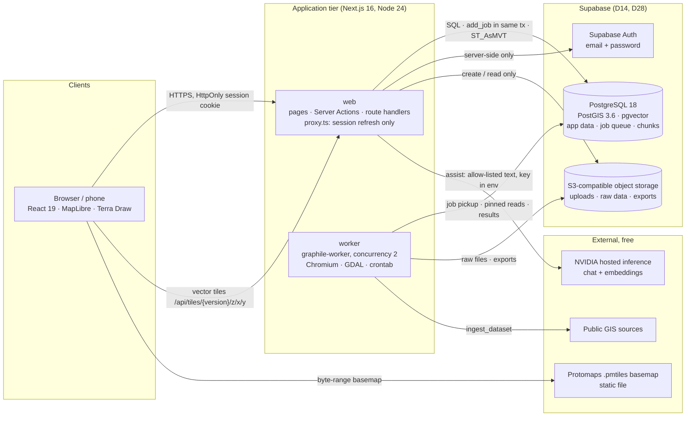
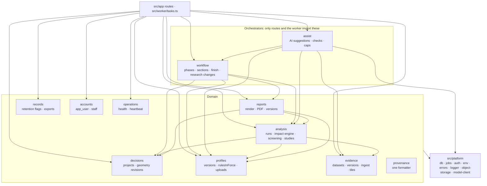
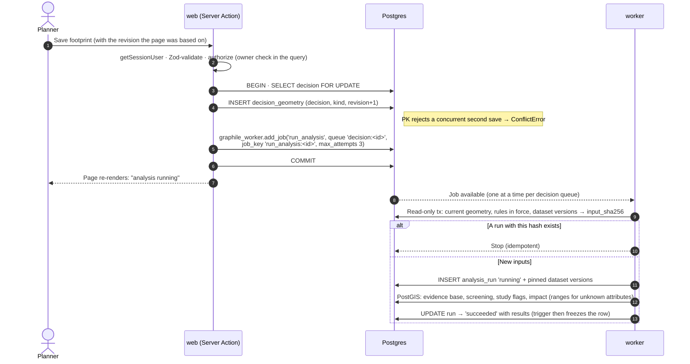
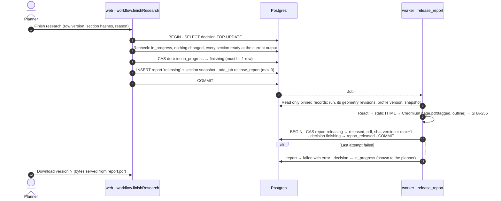
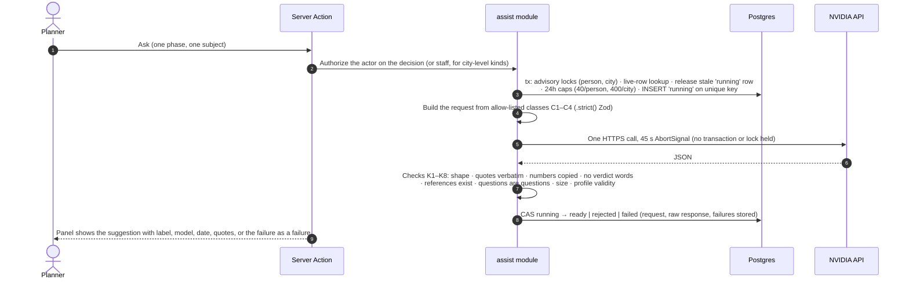

# UPlan — Technical Overview

**Kind:** System-level. It has no Requirements counterpart.
**Status:** Current as of 2026-10-16, read from the code and the TechDesign docs
**Audience:** an architect who needs the whole system from one document
**Detail lives in:** [system-architecture.md](system-architecture.md) · [data-model.md](data-model.md) · [tech-stack.md](tech-stack.md) · [alternatives-and-tradeoffs.md](alternatives-and-tradeoffs.md) (decisions D1–D28) · [ai-assist.md](ai-assist.md) · [deployment-guide.md](deployment-guide.md)

If this overview and one of those docs disagree, the detailed doc wins. Fix this overview to match it.

## 1. What the system does

UPlan helps municipal planners build the evidence behind a decision to develop habitat. A planner draws a **study area** and a **proposal footprint**. UPlan measures them in PostGIS against the city's **jurisdiction profile**, which holds the regulated critical-area types, buffers, and study triggers as versioned configuration, and against **evidence layers** taken from free public GIS data. The planner reads and edits each phase's report section (Site, Evidence, Screening, Studies, Footprint, Impact) and then publishes a **locked, versioned PDF report**.

Four product rules shape the architecture:

| Rule | What it means for the architecture |
| --- | --- |
| **P1 Provenance** | Every stored figure carries its source, date, and confidence. Every figure is displayed through one formatter (`src/modules/provenance`). |
| **P2 Screening never clears land** | No code path can produce "clear", "safe", or "no study needed". |
| **P3 The report is the product** | A report is built only from pinned, immutable records. After release, its bytes and hash never change. |
| **Posture** | The system never recommends. The AI model reads and quotes. It never measures, flags, or writes report text. |

## 2. Architecture at a glance

**Style:** a modular monolith with two process types, `web` and `worker`, sharing one PostgreSQL database (D1). The database is also the job queue, the lock manager, and the vector index. There is no Redis, no message broker, and no second datastore.



### Where it runs

| Environment | Web | Worker | Database | Status |
| --- | --- | --- | --- | --- |
| **Target (D28, 2026-10-10)** | Vercel functions | **Open.** Vercel has no long-lived process | Supabase Postgres, Auth, and Storage | Web, Auth, the database, and AI assist fit as designed. Jobs, PDF rendering, and GDAL ingestion still need a home (§12). |
| **Reference stack (D17, `deploy/`)** | `web` container behind Caddy (TLS, HTTP/3) | `worker` container (Playwright image, GDAL, Poppler) | `postgres` container with pgBackRest | Superseded as the target. Kept as working configuration: `Dockerfile` (`web`, `worker`, `migrate`, `postgres`) and `deploy/compose.yaml` |
| **Local (`LOCAL_HOSTING.md`)** | `npm run dev` | `npm run worker:dev` | Docker PostGIS + pgvector, or Supabase through `DATABASE_URL` | In daily use |

## 3. Logical architecture

All domain logic lives in `src/modules/<module>/`. Other code reaches a module only through its `index.ts`, and lint enforces both that boundary and the ban on import cycles. Routes (`src/app`) and job tasks (`src/worker/tasks.ts`) stay thin: authenticate, validate with Zod, call one module function.



- `reports` must not import `assist`. As a result, no AI output can reach a released document by any code path.
- `src/platform/model-client.ts` is the only code that calls the model. Only `assist` (and, later, `code-tracking`) may import it.
- Client components (`*.client.tsx`, `src/ui/`) import types only from modules and platform, never runtime code.

## 4. Technology choices

| Concern | Choice | Why (decision) |
| --- | --- | --- |
| Language and runtime | TypeScript 6 (strict), Node 24 LTS, npm | One language end to end. TypeScript 6 rather than 7 because typescript-eslint's type-aware rules (such as floating promises) don't support 7 yet (D3) |
| Web framework | Next.js 16 App Router, React 19, Server Actions | One deployable with no separate API server (D2) |
| UI | React Aria Components, Tailwind 4 | Accessible controls for WCAG 2.1 AA (D20) |
| Database | PostgreSQL 18 + PostGIS 3.6 + pgvector | Constraints, row locks, spatial measurement, and the vector index in one engine (D4, D21) |
| Data access | Drizzle ORM over `pg`; spatial SQL through bound `sql` templates | Typed queries, with SQL used directly where PostGIS needs it (D5) |
| Validation | Zod 4 at every boundary | Forms, uploads, environment, job payloads, profile documents, and model output (D6) |
| Background jobs | graphile-worker 0.18 | A Postgres-backed queue that supports enqueueing inside the same transaction as the data change (D8) |
| Spatial engine | PostGIS, measuring in the city's projected SRID (EPSG:2926 for Sammamish, US survey feet) | Numbers on screen and in the report come from one place. No geometry math in JavaScript (D9) |
| Maps | MapLibre GL 6, Terra Draw, PostGIS `ST_AsMVT` tiles, Protomaps `.pmtiles` basemap | Free and open, with no tile service (D10) |
| Ingestion | GDAL command-line tools in the worker | Reads every public GIS format (D11) |
| Report | React rendered to static HTML, printed by Playwright Chromium (`tagged: true`, `outline: true`), stored in `report.pdf` with its SHA-256 | Accessible PDF, protected by one transaction and one backup (D12, D23) |
| Identity | Supabase Auth through `@supabase/ssr`, called only from the server | No passwords stored by UPlan, and no key in the browser (D14) |
| AI | NVIDIA hosted inference (OpenAI-compatible) called with `fetch` + Zod, no SDK. Generation model `nvidia/nemotron-3-ultra-550b-a55b`; embeddings `nvidia/nemotron-3-embed-1b`, cut to 1,024 dimensions | Zero cost, with model ids pinned as constants (D27) |
| Excel | read-excel-file, write-excel-file | Profile upload, and a template generated from the profile schema (D13) |
| Logging | pino JSON to stdout | No log service needed (D22) |
| Testing | Vitest, Testcontainers (real PostGIS), Playwright + axe | No mocked database (D18) |

**Deliberately excluded:** paid APIs (Claude, OpenAI), any fallback model, Redis or a second datastore, a separate vector database, microservices or GraphQL, Turf.js, Next.js data caching (`use cache`, `revalidate`), feature-flag services, and native mobile apps.

## 5. Data architecture

**Core aggregate:** a `decision` (project), owned by its creator (D24) and belonging to a `jurisdiction`.

| Area | Tables | Pattern |
| --- | --- | --- |
| People | `app_user` (linked to Supabase by `auth_id`), `staff_member` | Staff rights come only from a row an operator creates |
| City rules | `jurisdiction` (with a current-version pointer), `profile_change`, `profile_version`, `profile_upload`, `profile_source` | The profile is an **immutable JSON document per version**. Rules carry `effectiveOn` and `repealedOn`. `rulesInForce(document, date)` is the single resolver |
| Evidence | `dataset`, `dataset_version`, `evidence_feature`, `jurisdiction_dataset` | A new version per refresh. The current pointer moves only when a version is `ready`. Each dataset records its license, which must be on an allow-list |
| Projects | `decision`, `decision_geometry` (PK: decision, kind, revision), `evidence_resolution`, `report_section_version` | Geometry is saved as revisions. Section versions and resolutions are append-only |
| Analysis | `analysis_run`, `analysis_run_dataset` | Pins its exact inputs and is deduplicated by `input_sha256`. Immutable once finished |
| Output | `report` | `releasing → released \| failed`. Holds the PDF as `bytea` plus its SHA-256 and a gap-free `version_number` |
| Records | `retention_flag`, `records_export` | Flags for staff review. UPlan never deletes anything on its own authority |
| AI | `ai_suggestion`, `ai_suggestion_response`, `source_document`, `document_chunk` (`vector(1024)`, HNSW) | Stored beside the analysis, never inside it |
| Ops | `worker_heartbeat`, `backup_run`, the `graphile_worker` schema | — |

**Conventions:**

- UUID primary keys.
- `*_at` columns are `timestamptz` in UTC. `*_on` columns are legal dates stored as `YYYY-MM-DD`.
- Statuses are `text` with `CHECK` lists, plus shape checks (for example, `failed` requires `error_detail`).
- No column has a default that stands in for missing data.
- Geometry is stored in EPSG:4326 and measured only after `ST_Transform` to `analysis_srid`.
- Values are stored unrounded and rounded only by the display formatter.

**Object storage:** keys are content hashes or record ids (`profile-uploads/<jurisdiction>/<sha256>.xlsx`, `evidence-raw/…`, `exports/…`). As a result, every write is idempotent. The client in `platform/object-storage.ts` exposes no delete and no overwrite.

**Migrations:** generated by drizzle-kit (`migrations/0000`–`0009`). They follow expand-then-contract, are never edited once applied, and never run when the app starts.

## 6. Key flows

### 6.1 Saving an input triggers an analysis run



A profile change, a new dataset version, or a rule reaching its effective date enqueues the same job, with the same key, for every affected open decision. Pending duplicates collapse into one job.

### 6.2 Finishing research and releasing the locked report



A later **research change** moves the decision from `report_released` back to `in_progress` with one compare-and-set, and enqueues a fresh analysis in the same transaction. Phases whose output fingerprint changed ask for review again. The next finish publishes version N+1. Earlier versions are never touched.

### 6.3 AI assist request (serverless-shaped, no worker)



A rule or metadata draft takes effect only after a **different** staff member confirms it, through the normal profile-change path. A unique partial index allows one confirmation per draft.

### 6.4 Profile upload or edit

1. Staff or a planner uploads an `.xlsx` (5 MB at most, with row limits) or saves the settings panel.
2. The workbook is parsed against the current template version. An unknown version is rejected and never guessed at. The person gets every problem at once.
3. One transaction applies the change:
   - Locks the jurisdiction row.
   - Compares the base revision the form carried with the current one.
   - Inserts the `profile_change` and the new `profile_version`.
   - Moves the current pointer.
   - Enqueues `run_analysis` for every open decision in the city.

## 7. Concurrency and consistency

Races are prevented by design, never by timing.

1. **Immutable versions.** Nothing other records depend on is ever updated. A change creates a new version. Triggers (`forbid_final_row_change`, `forbid_row_change`) enforce this even against a connection that holds write grants.
2. **Compare-and-set transitions.** `UPDATE … WHERE status = expected` must change exactly one row. Zero rows means `ConflictError`.
3. **Pointers move under `SELECT … FOR UPDATE`,** in the same transaction that creates the new version.
4. **One-at-a-time rules are constraints:**
   - the geometry revision primary key;
   - unique (jurisdiction, file hash) for uploads;
   - the partial unique index on live suggestions;
   - one confirmation per draft;
   - unique (decision, version_number) for reports.
5. **Transactional enqueue.** Every job is added with `graphile_worker.add_job()` inside the transaction that needs it. Jobs for one aggregate share a named queue, and job keys collapse duplicates.
6. **Pinned inputs and idempotent handlers.** Every job is keyed by its input hash or record id, so a retry after a crash creates nothing twice.
7. **No in-process state.** There are no in-memory locks, queues, or timers. Scheduled work runs from graphile-worker's crontab (`deploy/crontab`). The design is correct with any number of web and worker instances.
8. **Honest clients.** The browser sends the revision it edited, blocks double submission, and never shows a number it computed itself.

Each guard is required to have a race test: two real database connections run the competing operations at once, and the test asserts that exactly one succeeds.

## 8. Security decisions

| Area | Decision |
| --- | --- |
| Authentication | Supabase Auth with email and password, called **only from the server**. The browser has no Supabase client, so session cookies are forced `HttpOnly`, `SameSite=Lax`, and `Secure` in production (`platform/auth.ts`). Tokens are verified with `getClaims()` against Supabase's signing keys |
| Authorization | Enforced **inside module functions** on every read and write. A project query is scoped to its owner within the SQL, and anything else reads as "not found". Staff actions check `staff_member`. `src/proxy.ts` only refreshes the session and redirects signed-out visits. It is explicitly not a security boundary |
| Roles | Planner (everyone signed in); UPlan staff (approve profile changes, never their own; manage datasets; export records; confirm AI drafts). Reviewers return with F12 |
| Least privilege | The app connects as `uplan_app`, with only `select`/`insert` on append-only tables and no `delete` anywhere. Migrations run as the schema owner. Object-storage credentials can create and read but not overwrite or delete |
| Input validation | Zod at every boundary: forms, route params, uploads, job payloads, environment, and model responses. No `any`, and no `as` casts on external data |
| SQL injection | Every query is parameterized through Drizzle. SQL is never built by string concatenation |
| Secrets | Server-side environment variables, validated at startup. `NVIDIA_API_KEY` is never a `NEXT_PUBLIC_` variable and never appears in a log or a response. No secrets in the repository or in images |
| Data sent to third parties | The model service receives only C1 published code, C2 dataset metadata, C3 profile rules, and C4 de-identified measurements. It never receives a project title, parcel, applicant, notes, coordinates, files, or any name or email. A sentinel-string test enforces this, and every request is stored as sent, for audit |
| Prompt injection | The model has no tools and no write path, and its output has a fixed shape. Every statement must quote supplied text verbatim. The worst case is a rejected or misleading suggestion that is only displayed and changes nothing |
| Network (reference stack) | Only Caddy publishes ports (80/443). SSH only through OCI Bastion. The design calls for a Content Security Policy that permits MapLibre's blob workers and nothing broader. No CSP header is set in code yet (§12) |
| Logging | pino logs once at the boundary with the request or job id. No secrets, and no personal data beyond a user id |

## 9. Compliance decisions

| Obligation | How the architecture meets it |
| --- | --- |
| **ADA Title II / WCAG 2.1 AA.** Required of governments of 50,000+ people by 2027-04-26 | React Aria controls. Everything shown on the map is also available as text tables. axe runs in the end-to-end specs. Released PDFs are tagged, have an outline, a title on every SVG map, and header cells in every table |
| **Washington Public Records Act (RCW 42.56).** Working data is a public record | Nothing is deleted. A deleted project is hidden and keeps its records (D25). Daily `flag_retention` flags records past the city's retention setting for a staff decision. UPlan never deletes on its own. Scoped records exports are produced in formats the profile lists, and include AI requests, model ids, and prompt versions |
| **Defensible staff reports (P3)** | A report is built only from pinned records and stored immutably with its SHA-256. A trigger blocks any update or delete. Every figure carries provenance (source, publisher date, retrieval date, confidence). `retrieved_at` is never shown as the publisher's date |
| **Vesting (RCW 58.17.033)** | Rules are versioned by date. A city marks which rule types vest, and a vesting rule set resolves on the filing date. A missing filing date is a validation error and never defaults (assumed pending round 10) |
| **Data licensing** | Only free public data is ingested, checked against a license allow-list. No licensed, applicant, or consultant data becomes evidence. OpenStreetMap attribution is shown for the basemap |
| **Data minimization and residency** | Applicant and project data stay inside UPlan's infrastructure: the Supabase project and the app hosting. Supabase Auth holds only email, name, and password hash (D14). The NVIDIA allow-list is the only path to a third party |
| **Limits of desk analysis** | Significant trees are never counted. Field-rated attributes, such as a wetland's rating, are reported as ranges, never assumed. An empty result is stated as a fact and never as a clearance (P2) |
| **Open** | Whether NVIDIA's free-tier terms permit a city pilot. Whether Vercel Hobby's non-commercial clause covers one |

## 10. Resiliency

- **No fallbacks, by rule.** Missing data, a failed fetch, an unknown template version, an unreachable model, or a geometry a person drew that is invalid all fail visibly with a typed error (`ValidationError`, `ConflictError`, `ForbiddenError`, `NotFoundError`). Nothing substitutes a default, a cached copy, another source, or another model.
- **Bounded, idempotent retries.**
  - Computation jobs have `max_attempts: 3`, and network fetches 5.
  - After the last attempt, the owning row is marked `failed` and shown, and the health check fails.
  - A failed report puts the project back to `in_progress`. A failed dataset refresh leaves the previous version current, with the failure displayed beside it.
- **Crash safety.**
  - Transactional enqueue means a change never exists without its job, or a job without its change.
  - A killed AI call leaves a `running` row. The next request for the same key releases it as `interrupted` by compare-and-set.
- **Fail-fast configuration.** `platform/env.ts` parses the environment at import, so a missing variable crashes at startup, not mid-request. The one exception is `NVIDIA_API_KEY`, which is optional: when it is unset, the section chat and the profile assist panel show that assist isn't set up, and every phase still works.
- **Health check.** `GET /api/health` returns 200, or 503 naming the failing checks. It checks: the database, a worker heartbeat no more than 15 minutes old, WAL archiving, a backup within 26 hours, disk below 85%, and any job that used up its attempts in the last 24 hours. On the reference stack, an OCI synthetic monitor polls it every 10 minutes and emails staff.
- **Backups.**
  - *Reference stack:* pgBackRest with continuous WAL archiving (RPO about 15 minutes), nightly full or differential backups, encrypted, sent to a dedicated bucket. A restore is rehearsed quarterly.
  - *Supabase target:* the platform's own backups. Retention on the free plan is open (D28).
- **Dependency risk.** Supabase pauses a free project after a week idle. NVIDIA's free tier is rate-limited and has no SLA. AI is optional by design, so an NVIDIA outage never blocks the core workflow.

## 11. Scalability

| Dimension | Approach | Limit to watch |
| --- | --- | --- |
| Web tier | Stateless. No module-level mutable state, and every guard lives in the database. Scales horizontally on Vercel | Function duration (`maxDuration`) for slow calls |
| DB connections | Pool capped at **5 per process**, with keep-alive. Web uses Supabase's transaction pooler (6543). The worker needs a session or direct connection, because it uses LISTEN/NOTIFY | 15 session-mode clients on the free plan |
| Background work | Per-aggregate queues serialize work for one decision and parallelize across decisions. Worker concurrency is 2. Add worker instances to scale | No worker host on the Vercel target yet |
| Spatial compute | All in PostGIS, inside the database. Analysis runs are deduplicated by input hash. Bounding-box filters (`&&`) run before exact predicates | A large study area running in one function |
| Map tiles | `ST_AsMVT` per dataset version. Tile URLs name an immutable version, so they are cached `public, max-age=31536000, immutable`. This is the one cached response | — |
| Multi-tenancy | Every table is keyed by jurisdiction. A new city is a new profile plus dataset mappings, not a new design. A city switcher exists, with illustrative Redmond and Bellevue profiles | Evidence coverage per city |
| Storage | Reports as `bytea`, a few hundred KB each. List queries never read the PDF column | Supabase free database (about 500 MB): the first allowance likely to run out |
| AI | Caps of 40 requests per person and 400 per city per day, counted inside the claim transaction. One model call per invocation | NVIDIA rate limit. The current generation model has been timing out (§12) |

The system is sized for a pilot: one city and dozens of users, on free tiers. Each limit above is listed in the free-tier budget in [system-architecture.md](system-architecture.md), and any change that raises use of an allowance must update that table.

## 12. Known gaps and open decisions

| Gap | Impact | Where tracked |
| --- | --- | --- |
| **No worker host on the Vercel target.** `run_analysis`, `release_report` (Chromium), `ingest_dataset` (GDAL), the daily sweeps, and the heartbeat all assume graphile-worker | Without a worker, analysis and reports don't run in a pure Vercel deployment | D28 open items |
| Object storage env vars are still named `OCI_S3_*`, and `OCI_BUCKET_REPORTS` is required but unused | Configuration naming only. Supabase Storage's S3 endpoint fits the same client | data-model.md, *Object storage* |
| The health check's WAL, backup, and disk checks assume a self-run Postgres | On Supabase it would fail by design until those checks are redesigned | D28 |
| The Content Security Policy is designed but not set: neither `next.config.ts` nor the Caddyfile sends one | Browser hardening is missing until it is added | system-architecture.md, *Security and access* |
| No CI workflow file in the repo (`.github/` is absent), although D18 designs GitHub Actions CI | Checks run locally (`typecheck`, `lint`, `test`, `test:integration`, `test:e2e`) | D18 |
| The generation model `nemotron-3-ultra-550b-a55b` timed out in 2026-10-16 tests (embeddings answer in about 0.5 s) | Generation-based assist kinds fail visibly. A model-id change must pass `npm run eval:assist` | ai-assist.md, *As built* |
| Round 10 product questions: vesting semantics, who approves uploads, cities beyond Sammamish, whether F2 code tracking ships in release 1 | Each is contained to one module | charter.md |
| Later in v1: F2 code tracking, F12 sign-off, F13 conditions tracing, F15 phone views | Modules `code-tracking` and `conditions` aren't built yet | features.md |

## 13. Quality gates

| Layer | Tool | Rule |
| --- | --- | --- |
| Pure logic | Vitest (`npm test`) | No database and no network |
| SQL, constraints, triggers, races | Vitest + Testcontainers (`npm run test:integration`) | Real PostGIS, never a mock. Every concurrency guard has a race test |
| User flows and accessibility | Playwright + axe (`npm run test:e2e`) | No WCAG A or AA violations. Phone-width viewport |
| AI | `npm run eval:assist` | Planted failures must all be rejected. Golden questions run against the real service |
| Static | `npm run typecheck`, `npm run lint` | Type-aware lint, module boundaries, no cycles, no floating promises |

Every requirement id (`R1`, `R2`, …) has a test whose name starts with that id. Impact numbers are checked against hand-verified golden geometries. Running the same analysis inputs twice must produce byte-identical results.

## 14. Repository map

```
src/app/            routes only: pages, Server Actions, route handlers (/api/health, /api/tiles, documents)
src/modules/        domain modules: index.ts is the public API, tables.ts the Drizzle tables, tests beside the code
src/platform/       db pool · jobs (add_job) · auth · env · errors · logger · object-storage · model-client
src/ui/             shared React components (map workspace, footprint editor, phase pages)
src/worker/         graphile-worker entry point and task registry
migrations/         drizzle-kit SQL, append-only history
deploy/             reference VM stack: compose, Caddyfile, crontab, backup units, setup and deploy scripts
scripts/            seed-local, add-dataset, eval-assist, copy-maplibre-worker
Requirements/ · TechDesign/   charter → intents → features → paired Requirements and TechDesign docs per feature
```
